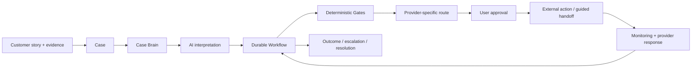

# RecoverIT

<p align="center">
  
</p>

<p align="center"><strong>AI revenue recovery for payment problems — from messy evidence to a verified, bounded action.</strong></p>

<p align="center">
  <a href="https://recoverit.hatchable.site">Live product</a> ·
  <a href="https://recoverit.hatchable.site/report.html">Try a payment check</a> ·
  <a href="./public/docs/ARCHITECTURE.md">Architecture</a> ·
  <a href="./public/docs/WORKFLOW.md">Workflow</a> ·
  <a href="./public/docs/EVALUATION.md">Evaluation</a>
</p>

<p align="center">
  
  
  
</p>

> **Core thesis:** **AI interprets. Deterministic controls decide.**

---

## 01 · See the product

RecoverIT is intentionally **not** presented as a chatbot. The customer gives the system one payment story; RecoverIT turns it into a durable case, builds the evidence trail, determines what is safe to do next, asks for approval before consequential action, and keeps monitoring until an outcome exists.


### One case, one operating loop

```text
REPORT → VERIFY → INVESTIGATE → ROUTE → APPROVE → MONITOR → RESOLVE
```

The animated diagram above is the public product story. The detailed technical state machine is below.

[Open the interactive product →](https://recoverit.hatchable.site)

---

## 02 · A concrete recovery journey

**Example:** a customer says a ₹18,500 refund was marked processed, but the money never reached the original payment account.

| Step | RecoverIT does | Customer sees |
|---|---|---|
| **Report** | turns the natural-language story into a case | one clear starting point |
| **Verify** | checks the attached proof | whether evidence is accepted |
| **Investigate** | reconstructs payment + refund facts | what is known / unknown |
| **Route** | prepares the legitimate provider path | exactly who will be contacted and why |
| **Approve** | blocks consequential action until consent | exact message, destination and evidence |
| **Monitor** | waits for provider response and schedules follow-up | only the next useful update |
| **Resolve** | confirms the actual outcome | resolved / escalated / needs action |


---

## 03 · Why this is a product, not an AI demo

Most payment-support experiences stop at **“here is what you could try.”** RecoverIT is built around a different unit of work:

```text
conversation
    ↓
DURABLE CASE
    ↓
evidence + payment facts + workflow state
    ↓
NEXT SAFE ACTION
    ↓
external response
    ↓
outcome
```

The case can continue after the browser closes because the next step is persisted as product state instead of living only in a chat history.

### Product principles

**Outcome over model output.** The user cares about the money, not the inference.

**Uncertainty is a state.** If evidence is incomplete or a verifier is unavailable, RecoverIT waits, retries, or asks for what is missing rather than inventing a payment state.

**Human authorization for consequential action.** A prepared route is not a sent route. The final action requires explicit user approval.

**Provider-specific execution.** The same recovery workflow can route through different payment, bank, UPI and merchant contexts.

---

## 04 · AI is inside a hard boundary


### AI handles interpretation

- natural-language payment stories
- multimodal document understanding
- structured fact extraction
- missing-information detection
- provider-response interpretation
- route / message preparation

### Deterministic systems handle authority

- authentication and ownership
- transaction/reference values
- timestamps and amounts
- evidence state and thresholds
- case-state transitions
- duplicate-action protection
- user approval
- idempotency and safe execution
- monitoring / notification schedules
- escalation eligibility
- resolution confirmation

This boundary is enforced in the product code, not just described in the README.

---

## 05 · Architecture at a glance



### The durable orchestration layer

```text
lib/case-workflow.js
        │
        ├── loads persisted case + evidence + dispute state
        ├── computes the authoritative next step
        ├── persists workflow_step / next_action / status / reason
        ├── schedules retries and background continuation
        └── advances after state-changing triggers
                │
                ▼
api/jobs/workflow-heartbeat.js
```

### Product-to-code map

| Product responsibility | Primary implementation |
|---|---|
| Durable case lifecycle | `lib/case-workflow.js` |
| Evidence verification | `lib/case-verification.js` |
| AI abstraction / failover | `lib/recoverit-ai.js` |
| Case reasoning | `lib/case-brain.js` |
| Recovery / dispute routing | `lib/dispute.js` |
| Recovery automation | `lib/dispute-automation.js` |
| Resolution policy | `lib/resolution.js` |
| External action gate | `api/cases/dispute-send.js` |
| Workflow read / advance | `api/cases/workflow-state.js`, `api/cases/workflow-advance.js` |
| Background continuation | `api/jobs/workflow-heartbeat.js` |
| Razorpay integration | `api/integrations/razorpay/*` |
| Bank / UPI reconciliation | `api/bank/reconcile.js`, `api/upi/reconcile.js` |
| Provider directory | `api/banks/directory.js`, `api/provider-intelligence/*` |
| End-to-end validation | `api/test-mode/e2e.js` |

---

## 06 · What happens when things fail?

Production systems are defined as much by their exceptions as by the happy path.

| Exception | RecoverIT behavior |
|---|---|
| Evidence cannot be verified | keep case blocked from consequential recovery; ask for correct proof |
| AI provider unavailable | preserve state, mark verification/investigation unavailable, retry |
| Conflicting payment facts | keep uncertainty visible; do not invent the missing state |
| Missing user information | surface a concrete next action |
| No legitimate route | do not fabricate a destination; keep the case actionable |
| User has not approved | action remains prepared, not sent |
| External response arrives | feed response back into the same workflow |
| Matching action already exists | deterministic duplicate protection prevents another matching action |

---

## 07 · Reliability and evaluation

### End-to-end verification

The repository includes a test-mode recovery harness covering the complete path from synthetic case creation through verified evidence, investigation, recovery preparation, approval gating, external response handling and resolution synchronization.

**Latest recorded E2E run: 21/21 checks passed.**

That is an engineering validation result, not a claim that all real-world payment cases will recover successfully.

### What should be measured next

```text
routing accuracy
       ↓
evidence verification accuracy
       ↓
workflow completion rate
       ↓
successful recovery rate
       ↓
amount recovered
       ↓
abstention / exception rate
```

RecoverIT deliberately does **not** invent production recovery percentages before there is a reproducible evaluation dataset.

[Read the evaluation methodology →](./public/docs/EVALUATION.md)

---

## 08 · Integrations and expansion path

The core workflow is provider-agnostic; integrations plug into the route and reconciliation layer.

```text
                    RecoverIT workflow
                           │
        ┌──────────────────┼──────────────────┐
        ▼                  ▼                  ▼
   Payment gateways      Banks               UPI
        │                  │                  │
   Razorpay routes     grievance paths    reconciliation
        └──────────────────┼──────────────────┘
                           ▼
                  merchant / provider response
```

Current repository surfaces include Razorpay transaction/refund integrations, bank reconciliation, UPI reconciliation, provider directories, Google Drive evidence import paths, and communications adapters.

[Read the integration notes →](./public/docs/INTEGRATIONS.md)

---

## 09 · Scaling the company, not just the demo

The long-term opportunity is not “a better complaint form.” It is a reusable **payment-resolution network**.

```text
one payment problem
        ↓
one durable recovery case
        ↓
verified evidence + route + outcome
        ↓
reusable playbook
        ↓
more providers / merchants / payment contexts
        ↓
more coverage + better operational data
```

The scaling strategy is therefore:

**Horizontal workflow scale** — background jobs and durable state continue cases without requiring an open browser.

**Provider expansion** — provider-specific routes attach to the same core state machine.

**Outcome learning** — successful and failed paths can become structured operational signals.

**Safety-preserving automation** — more automation does not remove the deterministic gates around consequential actions.

[Read the scalability notes →](./public/docs/SCALABILITY.md)

---

## 10 · Repository map

```text
RecoverIT/
├── README.md
├── api/
│   ├── cases/                 # case lifecycle, investigation, dispute, workflow
│   ├── evidence/              # upload + analysis
│   ├── integrations/          # Razorpay, Google Drive, integration health
│   ├── jobs/                  # monitoring, verification, workflow heartbeat
│   ├── bank/ + upi/           # reconciliation
│   ├── notifications/         # user updates
│   ├── outcomes/              # outcome learning
│   └── test-mode/              # reproducible recovery harness
├── lib/
│   ├── case-workflow.js       # authoritative workflow engine
│   ├── case-verification.js   # evidence verification
│   ├── case-brain.js          # case reasoning
│   ├── recoverit-ai.js        # AI abstraction / failover
│   ├── dispute.js             # route + recovery logic
│   ├── dispute-automation.js  # follow-ups
│   └── resolution.js          # resolution policy
├── migrations/                # PostgreSQL schema evolution
├── public/                    # product UI + visual assets
│   ├── app.html
│   ├── case.html
│   ├── report.html
│   ├── resolution.html
│   └── assets/                # diagrams used in this README
└── pages/                     # server-rendered share pages
```

---

## 11 · Quick start

### Run the product

The live product is available at:

**https://recoverit.hatchable.site**

Try the public payment checker first, then create a full case when you want a durable workflow.

### Explore the code

```bash
# case orchestration
grep -n "advanceCaseWorkflow" lib/case-workflow.js

# evidence verification
grep -n "analyzeDocument" lib/case-verification.js

# action safety gate
grep -n "USER_APPROVED" api/cases/dispute-send.js
```

The repository is designed to be published with the source and architecture, not production credentials, customer evidence, or private infrastructure state.

---

## 12 · Documentation

| Document | Purpose |
|---|---|
| [`PRODUCT.md`](./public/docs/PRODUCT.md) | product thesis and user value |
| [`ARCHITECTURE.md`](./public/docs/ARCHITECTURE.md) | system boundaries and major components |
| [`WORKFLOW.md`](./public/docs/WORKFLOW.md) | durable case workflow |
| [`AI-SAFETY.md`](./public/docs/AI-SAFETY.md) | AI vs deterministic responsibility |
| [`RELIABILITY.md`](./public/docs/RELIABILITY.md) | failure handling and continuation |
| [`EVALUATION.md`](./public/docs/EVALUATION.md) | reproducible evaluation plan |
| [`INTEGRATIONS.md`](./public/docs/INTEGRATIONS.md) | provider and evidence integrations |
| [`SCALABILITY.md`](./public/docs/SCALABILITY.md) | how the architecture can grow |
| [`SECURITY.md`](./public/docs/SECURITY.md) | security considerations |
| [`DEMO.md`](./public/docs/DEMO.md) | judge/demo sequence |

---

## 13 · Current status

RecoverIT is an **active early-stage product build** with a working full-stack recovery workflow.

The architecture is intentionally designed to support a future production system, but this repository does **not** claim production-scale financial volume today. The next proof points are measured recovery quality, broader provider coverage, deeper observability, and higher-confidence real-world evaluation.

### The company thesis

> **Start with one payment problem. Build the system that can stay with it until the money has an outcome.**

That is the product. The durable workflow, provider network, evidence graph, operational data and outcome learning are what can compound into the company.

---

## License

See [`public/LICENSE`](./public/LICENSE).