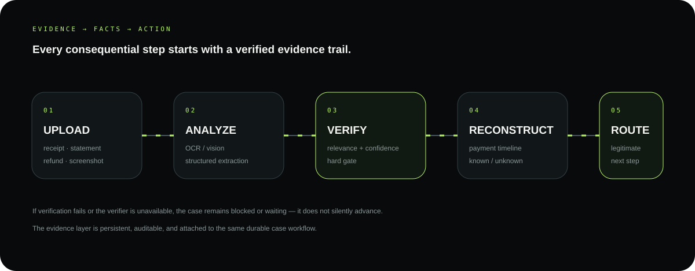
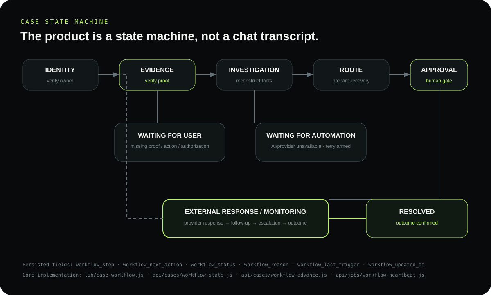
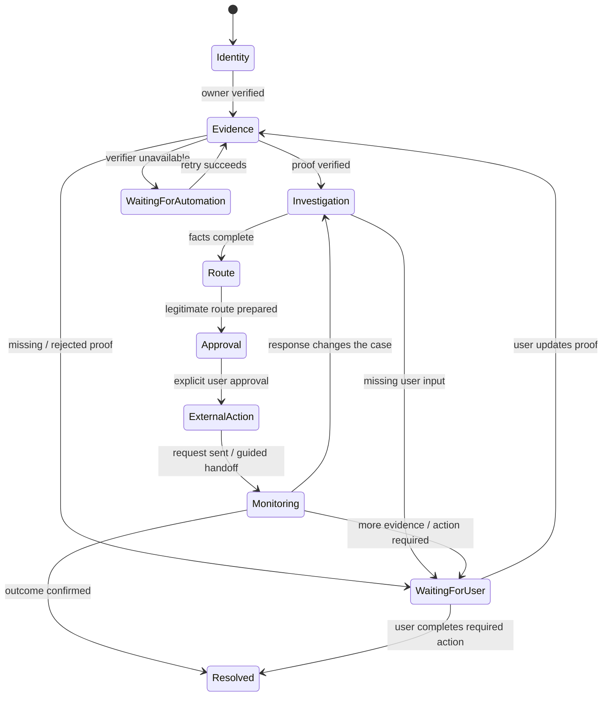
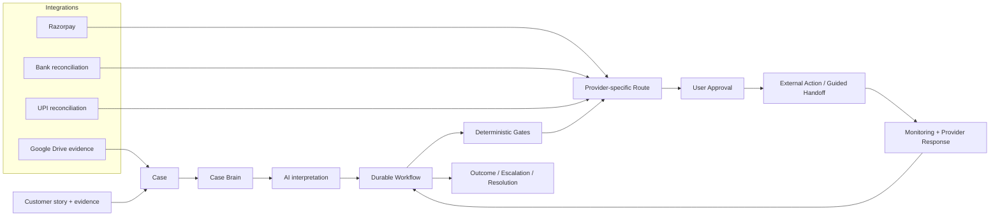
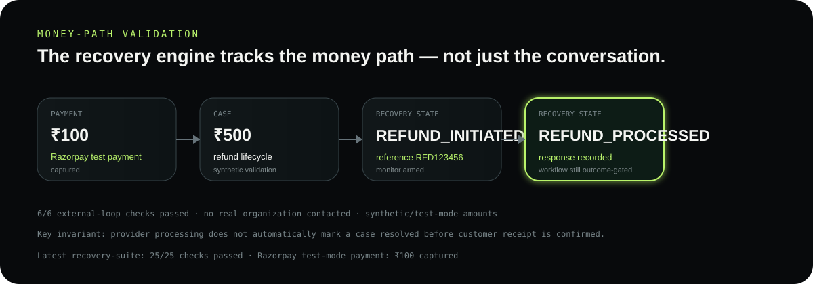
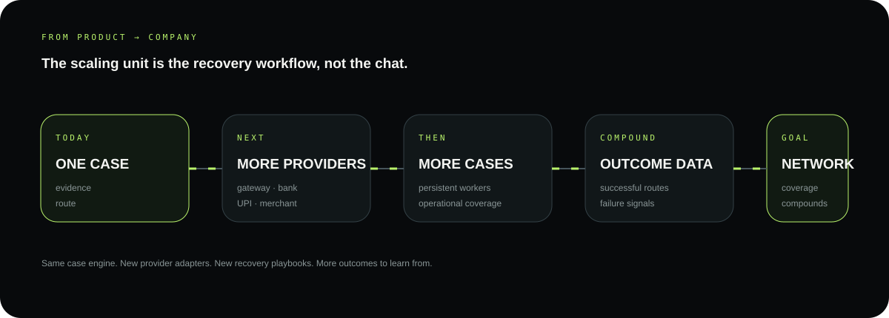

# RecoverIT

<p align="center">
  
</p>

<p align="center">
  <strong>AI revenue recovery for payment problems.</strong><br/>
  From a messy payment story to a verified, bounded, auditable recovery action.
</p>

<p align="center">
  <a href="https://recoverit.hatchable.site"><b>Live product</b></a> ·
  <a href="https://recoverit.hatchable.site/report.html"><b>Try the payment check</b></a> ·
  <a href="#architecture"><b>Architecture</b></a> ·
  <a href="#workflow"><b>Workflow</b></a> ·
  <a href="#evaluation"><b>Evaluation</b></a>
</p>

<p align="center">
  
  
  
</p>

> **Core thesis:** **AI interprets. Deterministic controls decide.**

---

## 01 · The product in one screen

RecoverIT is not a chat window that generates a support reply. It is a **living recovery case**.

The customer tells RecoverIT what happened once. The product keeps the case, evidence, payment facts, next action, approval state and outcome together until the issue actually reaches a useful endpoint.

<p align="center">
  
</p>

### One-line product model

```text
REPORT → VERIFY → INVESTIGATE → RECOVER → APPROVE → MONITOR → RESOLVE
```

**The important part:** the workflow is persisted. Closing the browser does not erase the next action.

---

## 02 · A real recovery journey

**Scenario:** a customer says a **₹18,500 refund was marked processed, but the money never reached the original payment account.**

| Product step | What RecoverIT does | What the customer gets |
|---|---|---|
| Report | creates a durable case from the story | one clear starting point |
| Verify | checks the evidence | trusted / blocked status |
| Investigate | reconstructs payment + refund facts | known vs unknown |
| Recover | prepares the legitimate provider route | exact next route |
| Approve | waits for explicit consent | exact action before send |
| Monitor | follows the provider response | only the next useful update |
| Resolve | confirms the outcome | resolved / escalated / action needed |

<p align="center">
  
</p>

---

## 03 · Why this is a product, not an AI demo

Most AI support experiences end at **“here is what you can try.”** RecoverIT treats the case itself as the product primitive.

```text
story
  ↓
durable case
  ↓
evidence + payment facts
  ↓
authoritative next action
  ↓
approved external action
  ↓
provider response
  ↓
continued workflow
  ↓
outcome
```

### Product properties

| Property | What it means in RecoverIT |
|---|---|
| **Persistent** | the case and next action survive the browser session |
| **Evidence-driven** | consequential progress requires the right evidence state |
| **Bounded** | AI does not directly authorize money-related actions |
| **Provider-aware** | routes adapt to payment, bank, UPI and merchant contexts |
| **Resumable** | background workers can continue active cases |
| **Auditable** | workflow state, triggers and decisions are persisted |

---

## 04 · Workflow: the product is a state machine

<p align="center">
  
</p>



The state machine is backed by persisted fields such as `workflow_step`, `workflow_next_action`, `workflow_status`, `workflow_reason`, and `workflow_updated_at`.

---

## 05 · AI lives inside a hard boundary

<p align="center">
  
</p>

### AI is used where interpretation helps

Natural-language stories, multimodal evidence, structured fact extraction, missing-information detection, provider-response interpretation, and route/message preparation.

### Deterministic logic is used where authority matters

Identity, ownership, transaction/reference values, timestamps, amounts, evidence status, state transitions, approval, idempotency, monitoring, escalation eligibility and resolution confirmation.

> **AI can recommend the next step. It cannot authorize the consequential step.**

<details>
<summary><b>How the action gate works</b></summary>

A prepared recovery route is not automatically sent. RecoverIT requires the relevant state and evidence checks, an exact prepared route, and explicit user approval before a consequential external action.

Core implementation includes `lib/case-workflow.js`, `lib/case-verification.js`, `lib/recoverit-ai.js`, `lib/dispute.js`, and `api/cases/dispute-send.js`.

</details>

---

<a id="architecture"></a>
## 06 · Architecture



### The durable orchestration layer

```text
lib/case-workflow.js
     │
     ├─ loads persisted case + evidence + dispute state
     ├─ computes the authoritative next step
     ├─ persists workflow_step / next_action / status / reason
     ├─ arms retries and background continuation
     └─ advances after state-changing triggers
                 │
                 ▼
api/jobs/workflow-heartbeat.js
```

<details>
<summary><b>Product → code map</b></summary>

| Product responsibility | Primary implementation |
|---|---|
| Durable case lifecycle | `lib/case-workflow.js` |
| Evidence verification | `lib/case-verification.js` |
| AI abstraction / failover | `lib/recoverit-ai.js` |
| Case reasoning | `lib/case-brain.js` |
| Recovery / dispute routing | `lib/dispute.js` |
| Recovery automation | `lib/dispute-automation.js` |
| Resolution policy | `lib/resolution.js` |
| External action gate | `api/cases/dispute-send.js` |
| Workflow read / advance | `api/cases/workflow-state.js`, `api/cases/workflow-advance.js` |
| Background continuation | `api/jobs/workflow-heartbeat.js` |
| Razorpay integration | `api/integrations/razorpay/*` |
| Bank / UPI reconciliation | `api/bank/reconcile.js`, `api/upi/reconcile.js` |
| End-to-end validation | `api/test-mode/e2e.js` |

</details>

---

## 07 · What happens when the system is uncertain?

RecoverIT treats uncertainty as a **product state**, not an excuse to guess.

<details>
<summary><b>Failure and recovery paths</b></summary>

| Situation | System behavior |
|---|---|
| Evidence rejected | case remains blocked and asks for correct proof |
| Evidence needs review | case waits instead of sending recovery action |
| AI provider unavailable | state is preserved and retry is armed |
| Payment facts conflict | uncertainty stays visible; no invented state |
| Missing user information | next required action is surfaced |
| No legitimate route | no fabricated destination; case remains actionable |
| Approval missing | action remains prepared, not sent |
| Provider response arrives | response re-enters the same workflow |
| Matching action already exists | duplicate protection prevents another matching action |

</details>

---

## 08 · Evaluation and reliability

The repository contains a reproducible test-mode recovery harness covering synthetic case creation, evidence verification, investigation, recovery preparation, approval gating, external response handling and resolution synchronization.

**Latest recorded end-to-end run: 21/21 checks passed.**

That is an engineering validation result — not a claim that every real-world payment case will recover successfully.

### Money-path evidence

The current build already validates the **financial state machine** in test mode. We show the exact monetary path we can substantiate today rather than inventing a production recovery percentage.

<p align="center">
  
</p>

| Evidence | Observed result |
|---|---|
| **Razorpay test payment** | ₹100 captured successfully in test mode |
| **Refund lifecycle** | ₹500 synthetic refund progressed from `REFUND_INITIATED` to `REFUND_PROCESSED` |
| **Monitoring** | refund monitor was active while the refund was being tracked |
| **Outcome guard** | provider processing did not automatically mark the case resolved before customer receipt |
| **External-loop validation** | **6/6 checks passed** |
| **Recovery-suite validation** | **25/25 checks passed** |
| **Eligible route coverage** | **13 eligible routes** discovered in the recovery suite |

> **Read this correctly:** the ₹500 and ₹100 figures are **test-mode / synthetic validation amounts**. They prove that RecoverIT can track, reconcile and gate a money-recovery workflow; they are **not claims of real customer funds recovered**.

### The metrics to earn next

```text
routing accuracy
      ↓
evidence verification accuracy
      ↓
workflow completion rate
      ↓
eligible recovery rate
      ↓
₹ at risk → ₹ recovered
      ↓
abstention / exception rate
      ↓
unsafe actions prevented
```

The next business-grade benchmark is a reproducible batch with labeled outcomes so the repository can publish **cases processed, ₹ at risk, ₹ recovered, recovery rate, route accuracy, abstentions, escalations and unsafe-action count**.

[Evaluation methodology →](./public/docs/EVALUATION.md)

---

<a id="workflow"></a>
## 09 · Scaling path: from one case to a company

<p align="center">
  
</p>

The company opportunity is to turn the same durable recovery engine into a broader **payment-resolution network**:

**More providers** → more legitimate routes.

**More cases** → more operational coverage.

**More outcomes** → better playbooks and stronger provider intelligence.

**More automation** → lower manual effort, while the deterministic safety boundary remains intact.

[Scalability notes →](./public/docs/SCALABILITY.md)

---

## 10 · Repository map

```text
RecoverIT/
├── README.md
├── api/
│   ├── cases/                 # lifecycle, investigation, dispute, workflow
│   ├── evidence/              # upload + analysis
│   ├── integrations/          # Razorpay, Google Drive, health
│   ├── jobs/                  # verification, monitoring, workflow heartbeat
│   ├── bank/ + upi/           # reconciliation
│   ├── notifications/         # user updates
│   ├── outcomes/              # outcome learning
│   └── test-mode/              # reproducible recovery harness
├── lib/
│   ├── case-workflow.js       # authoritative workflow engine
│   ├── case-verification.js   # evidence verification
│   ├── case-brain.js          # case reasoning
│   ├── recoverit-ai.js        # AI abstraction / failover
│   ├── dispute.js             # route + recovery logic
│   ├── dispute-automation.js  # follow-ups
│   └── resolution.js          # resolution policy
├── migrations/                # PostgreSQL schema evolution
├── public/                    # product UI + visual assets
└── pages/                     # server-rendered share pages
```

---

## 11 · Run the product

**Live product:** https://recoverit.hatchable.site

Start with the public payment checker, then create a full case to see the durable workflow.

```bash
# orchestration
grep -n "advanceCaseWorkflow" lib/case-workflow.js

# evidence verification
grep -n "analyzeDocument" lib/case-verification.js

# consequential-action gate
grep -n "USER_APPROVED" api/cases/dispute-send.js
```

> Production credentials, private customer evidence and deployed infrastructure state are intentionally not part of the repository.

---

## 12 · Technical documentation

| Document | Focus |
|---|---|
| [`PRODUCT.md`](./public/docs/PRODUCT.md) | product thesis |
| [`ARCHITECTURE.md`](./public/docs/ARCHITECTURE.md) | system boundaries |
| [`WORKFLOW.md`](./public/docs/WORKFLOW.md) | durable state machine |
| [`AI-SAFETY.md`](./public/docs/AI-SAFETY.md) | AI vs authority |
| [`RELIABILITY.md`](./public/docs/RELIABILITY.md) | failure handling |
| [`EVALUATION.md`](./public/docs/EVALUATION.md) | evaluation methodology |
| [`INTEGRATIONS.md`](./public/docs/INTEGRATIONS.md) | provider integrations |
| [`SCALABILITY.md`](./public/docs/SCALABILITY.md) | expansion path |
| [`SECURITY.md`](./public/docs/SECURITY.md) | security considerations |
| [`DEMO.md`](./public/docs/DEMO.md) | judge/demo sequence |

---

## Current status

RecoverIT is an **active early-stage product build** with a working full-stack recovery workflow.

The architecture is designed as a foundation for a production system, but the repository deliberately does **not** claim production-scale financial volume or fabricated recovery percentages.

> **Start with one payment problem. Build the system that can stay with it until the money has an outcome.**

That is the product. The durable workflow, provider network, evidence graph, operational data and outcome learning are the path to the company.

---

## License

See [`public/LICENSE`](./public/LICENSE).