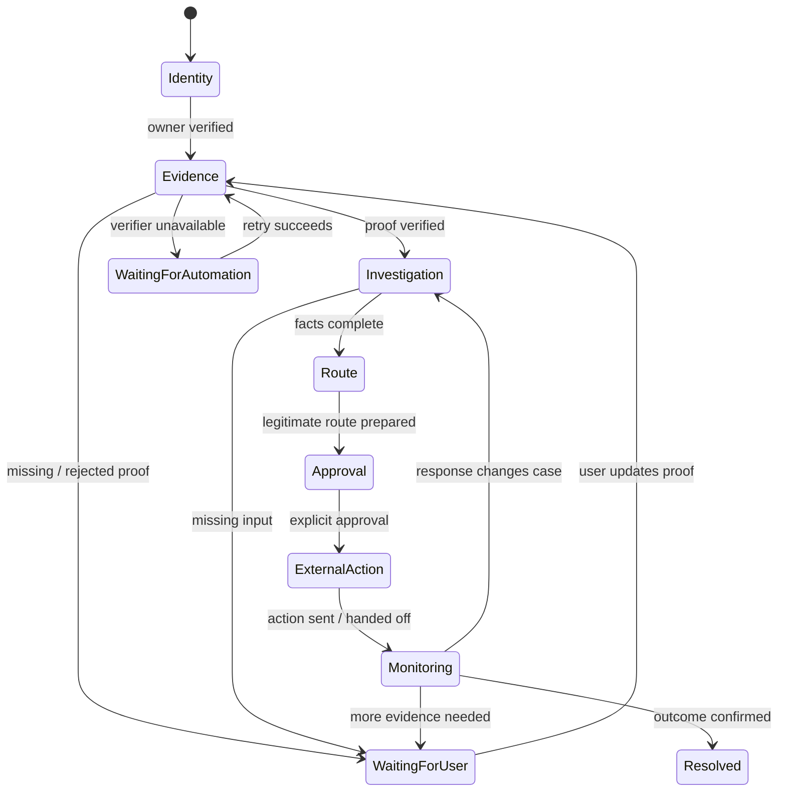
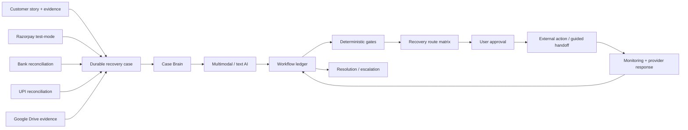

[](https://hatchable.com/deploy?repo=https://github.com/Prakash-codeMaker/RecoverIT)

# RecoverIT

<p align="center">
  
</p>

<p align="center">
  <strong>AI-powered payment recovery infrastructure.</strong><br/>
  RecoverIT turns a messy payment problem into a verified, auditable workflow that stays with the case until there is an outcome.
</p>

<p align="center">
  <a href="https://recoverit.hatchable.site"><strong>Live product</strong></a> ·
  <a href="https://recoverit.hatchable.site/report.html"><strong>Try RecoverIT</strong></a> ·
  <a href="./public/docs/DEMO.md"><strong>Demo</strong></a> ·
  <a href="./public/docs/ARCHITECTURE.md"><strong>Architecture</strong></a> ·
  <a href="./public/docs/EVALUATION.md"><strong>Evaluation</strong></a>
</p>

> **Core idea:** AI handles ambiguity. Deterministic software handles authority.

---

## What is RecoverIT?

RecoverIT is a payment-recovery system for the moment when a transaction does not end cleanly.

A customer might have a bank debit, a merchant order, a gateway reference, a refund message and a screenshot — while each system tells only part of the story. RecoverIT brings those fragments into one durable **recovery case**.

The system can understand the customer's story, interpret evidence, reconstruct the payment timeline, identify what is missing, prepare a legitimate recovery route, ask for approval before consequential contact, monitor what happens next and continue the same case when new information arrives.

It is deliberately built as a **workflow system with AI inside it**, not as a chatbot with a payment-themed interface.

---

## The customer experience

```text
Tell us what happened
        ↓
Attach whatever proof you have
        ↓
RecoverIT understands + verifies the evidence
        ↓
Payment facts and timeline are reconstructed
        ↓
The next legitimate recovery path is prepared
        ↓
You review the exact consequential action
        ↓
RecoverIT follows up / monitors the case
        ↓
The same case continues until resolution or escalation
```

The browser is only the interface. **The case itself is the durable product.**

<p align="center">
  
</p>

---

## Why this problem is hard

Payment recovery crosses boundaries that ordinary support software treats as separate tickets:

- customer statements are unstructured;
- receipts and bank records are documents, images or PDFs;
- transaction references must match exactly;
- payment and refund states can change asynchronously;
- different providers expose different recovery routes;
- a provider can ask for another document later;
- an action can be retried or duplicated;
- “processed” is not necessarily the same as “customer received the money.”

A useful system therefore needs more than good language generation. It needs **evidence, state, policy, persistence and time**.

---

## The product loop

RecoverIT models the complete journey as:

```text
REPORT → VERIFY → INVESTIGATE → RECOVER → APPROVE → MONITOR → RESOLVE
```

### 1. Report

The customer explains the issue in natural language. They do not need to know which provider API, payment state or support category applies.

### 2. Verify

Evidence is uploaded and interpreted using multimodal AI. RecoverIT separates evidence that is **verified**, **needs review**, **rejected**, or **temporarily unavailable for verification**.

### 3. Investigate

The system builds a structured view of the payment facts, evidence, timeline and unresolved questions.

### 4. Recover

A deterministic route matrix selects a legitimate next step from the available payment/provider context.

### 5. Approve

For consequential external actions, the exact destination, channel, message and evidence bundle are shown before anything is sent.

### 6. Monitor

Provider responses, refund/payment state and outstanding requirements are attached to the same case.

### 7. Resolve

The case closes only when the relevant outcome evidence supports resolution; otherwise it waits, requests input or escalates.

---

## What AI does — and what it does not do

AI is valuable here because the inputs are messy. Financial authority is valuable precisely because some outputs must **not** be guessed.

### AI layer

AI is used for:

- natural-language story understanding;
- multimodal document and image interpretation;
- structured fact extraction;
- missing-information detection;
- payment/provider response interpretation;
- route and message preparation;
- multilingual/voice-ready interaction layers.

### Deterministic layer

Application code owns:

- authentication and case ownership;
- exact transaction/reference/amount facts;
- evidence gates;
- route and destination legitimacy;
- workflow transitions;
- explicit approval;
- duplicate/idempotency protection;
- retries and monitoring;
- escalation eligibility;
- resolution confirmation.

<p align="center">
  
</p>

> A model may recommend the next step. A model cannot authorize the consequential step.

This boundary is the foundation of the system.

---

## A case is a state machine, not a conversation

A RecoverIT case can pause safely and resume later.



The durable workflow ledger stores:

```text
workflow_step
workflow_next_action
workflow_status
workflow_reason
workflow_last_trigger
workflow_updated_at
```

This makes the answer to “what happens next?” a database fact rather than an inference from a previous chat message.

See [`WORKFLOW.md`](./public/docs/WORKFLOW.md).

---

## Evidence is part of the control plane

<p align="center">
  
</p>

Evidence follows:

```text
UPLOAD
  ↓
MULTIMODAL ANALYSIS
  ↓
VERIFICATION
  ↓
STRUCTURED FACTS
  ↓
TIMELINE / PAYMENT RECONCILIATION
  ↓
ROUTE ELIGIBILITY
```

RecoverIT intentionally distinguishes:

| Status | Meaning | Consequence |
|---|---|---|
| **VERIFIED** | Sufficient evidence for the relevant gate | Can unlock the next gated stage |
| **REVIEW** | Evidence exists but should not authorize a consequential action | Case continues safely; action stays blocked |
| **REJECTED** | Evidence is unsuitable for the requested purpose | Request appropriate replacement |
| **UNAVAILABLE / RETRYING** | Verification infrastructure is temporarily unavailable | Preserve case and retry/fail over |

A verifier outage should never make the customer's evidence disappear.

---

## Consequential actions are explicit

RecoverIT never treats an AI-generated suggestion as permission to contact an external party.

```text
verified evidence
      +
consistent case facts
      +
legitimate route
      +
prepared action
      +
explicit user approval
      ↓
external action
```

If a required condition is missing, the action remains blocked or waiting.

The enforcement boundary is visible in `api/cases/dispute-send.js`.

---

## Architecture



### Component map

| Component | Responsibility |
|---|---|
| `lib/case-workflow.js` | Authoritative workflow orchestration |
| `lib/case-verification.js` | Evidence verification and retryable states |
| `lib/recoverit-ai.js` | AI provider abstraction and failover |
| `lib/case-brain.js` | Structured case reasoning and reconstruction |
| `lib/dispute.js` | Recovery route matrix and action preparation |
| `lib/dispute-automation.js` | Follow-up automation |
| `lib/resolution.js` | Outcome and resolution policy |
| `api/cases/dispute-send.js` | Consequential-action approval gate |
| `api/cases/workflow-state.js` | Workflow state surface |
| `api/cases/workflow-advance.js` | Workflow advancement |
| `api/jobs/workflow-heartbeat.js` | Background continuation |
| `api/evidence/upload.js` | Evidence ingestion |
| `api/evidence/analyze.js` | Evidence analysis |
| `api/integrations/razorpay/*` | Payment/refund integration |
| `api/bank/reconcile.js` | Bank-side reconciliation |
| `api/upi/reconcile.js` | UPI-side reconciliation |
| `lib/user-notifications.js` | Deduplicated user notifications |
| `api/test-mode/*` | Synthetic end-to-end validation |

---

## AI provider strategy

RecoverIT treats model availability as an engineering variable, not a product assumption.

Text workloads support provider fallback across the shared AI abstraction. Multimodal evidence uses a modality-aware order so a PDF is not blindly sent to a provider that only supports image inputs.

The abstraction validates structured output instead of treating an HTTP 200 as semantic success.

This is implemented in [`lib/recoverit-ai.js`](./lib/recoverit-ai.js).

---

## Reliability is part of the product

Long-running payment workflows fail in different ways. RecoverIT turns those failures into explicit states.

| Failure | System behavior |
|---|---|
| AI/provider timeout | Preserve case; retry/fail over |
| Evidence rejected | Keep gate closed; request correct proof |
| Evidence needs review | Continue safely; block consequential action |
| Missing user information | Create a specific waiting action |
| Provider facts conflict | Preserve uncertainty; do not guess |
| No legitimate route | Do not invent a destination |
| Approval missing | Keep action prepared but unsent |
| Duplicate action | Block matching action |
| Provider response arrives later | Feed it back into the same case |
| Browser closes | Background workers continue the workflow |

### A real failure that changed the architecture

The first evidence-preflight design made synchronous multimodal verification part of case creation. A slow AI provider could therefore turn a temporary timeout into a complete case-creation failure.

The architecture was changed to separate:

```text
Evidence staging  ≠  Evidence authorization
```

Now the evidence can be retained, the case can continue into a safe review/unverified state, and verification can retry or fail over. Consequential actions remain fail-closed until the relevant gate is satisfied.

That is a product-level reliability guarantee, not merely a UI retry button.

See [`RELIABILITY.md`](./public/docs/RELIABILITY.md).

---

## Validation

RecoverIT includes a synthetic end-to-end harness that exercises the actual workflow contracts.

### Latest recorded run

**21/21 checks passed — September 2, 2026.**

The run covered:

- database/schema reachability;
- synthetic case creation;
- evidence-analysis contract;
- **13 eligible recovery routes**;
- first recovery-action preparation;
- persisted action attempt;
- awaiting-response transition;
- organization response capture;
- requested-document tracking;
- replacement evidence satisfying the exact requirement;
- same-organization follow-up;
- same-case continuity;
- approval enforcement;
- resolution-state synchronization;
- multimodal AI availability.

The recorded multimodal probe also exercised provider fallback.

These are engineering/test results. They are **not** presented as a production recovery rate or as real customer money recovered.

See [`EVALUATION.md`](./public/docs/EVALUATION.md).

<p align="center">
  
</p>

---

## Integrations

| Integration | Role |
|---|---|
| **Razorpay** | Test-mode payment/refund probes and payment-state integration |
| **Bank reconciliation** | Bank-side payment context |
| **UPI reconciliation** | UPI-specific payment context |
| **Google Drive** | Optional evidence import |
| **Email** | Meaningful case and action-needed notifications |
| **Twilio SMS** | Important/action-needed SMS notifications |

External providers supply evidence or execution capabilities; they do not bypass the case's policy and approval boundary.

See [`INTEGRATIONS.md`](./public/docs/INTEGRATIONS.md).

---

## Test Mode

The repository includes a protected synthetic scenario for inspecting the recovery workflow without contacting a real organization.

```text
synthetic payment
      ↓
refund initiated
      ↓
conflicting information
      ↓
duplicate recovery attempt
      ↓
protection + Action Ledger
```

Open [`/test-mode.html`](https://recoverit.hatchable.site/test-mode.html) after signing in.

Synthetic amounts and records are explicitly treated as test data.

---

## Data model

The durable state is distributed across purpose-specific PostgreSQL tables instead of being stored in an LLM transcript.

```text
recovery_cases
├── evidence
│   └── evidence_analysis
├── case_brain
├── case_payment_context
├── financial_transactions
├── payment_monitors
├── dispute_state
│   ├── dispute_attempts
│   ├── dispute_requirements
│   └── dispute_responses
├── case_resolution_state
├── action_executions
├── notifications
└── outcome / feedback signals
```

This lets the system retry interpretation, ingest a later provider response, satisfy a document requirement or resume a case without replaying an entire conversation.

---

## Repository structure

```text
RecoverIT/
├── README.md
├── hatchable.toml
├── api/
│   ├── cases/                 # lifecycle, investigation, recovery, workflow
│   ├── evidence/              # upload + analysis
│   ├── integrations/          # external providers
│   ├── jobs/                  # background continuation
│   ├── bank/ + upi/            # reconciliation
│   ├── notifications/         # notification APIs
│   └── test-mode/              # synthetic validation
├── lib/
│   ├── case-workflow.js       # workflow engine
│   ├── case-verification.js   # evidence verification
│   ├── recoverit-ai.js        # AI abstraction/failover
│   ├── case-brain.js          # case reasoning
│   ├── dispute.js             # route matrix
│   ├── dispute-automation.js  # follow-ups
│   ├── resolution.js          # outcome policy
│   └── user-notifications.js  # notifications
├── migrations/                # ordered PostgreSQL evolution
├── public/
│   ├── index.html             # product site
│   ├── report.html            # entry flow
│   ├── case.html              # live case
│   ├── test-mode.html         # synthetic scenario
│   ├── assets/                # product/architecture visuals
│   └── docs/                  # technical documentation
└── pages/
    └── share/[token].js       # shareable case surface
```

---

## Technology

**Application:** JavaScript / HTML / CSS

**Runtime:** Hatchable serverless runtime

**Database:** PostgreSQL

**AI:** managed multimodal/text model gateway with provider fallback

**Storage:** managed object storage for evidence

**Authentication:** passwordless email-code authentication

**Scheduling:** durable scheduled workers for verification, monitoring, follow-up and workflow heartbeat

**Payments:** Razorpay test-mode integration

**Communication:** managed email + Twilio SMS

The runtime intentionally keeps provider credentials outside source control.

---

## Running and inspecting the product

### Fastest path

1. Open the [live product](https://recoverit.hatchable.site).
2. Try the [payment-check entry point](https://recoverit.hatchable.site/report.html).
3. Read [`PRODUCT.md`](./public/docs/PRODUCT.md) for the product model.
4. Read [`WORKFLOW.md`](./public/docs/WORKFLOW.md) for the durable state machine.
5. Read [`AI-SAFETY.md`](./public/docs/AI-SAFETY.md) for the AI boundary.
6. Read [`ARCHITECTURE.md`](./public/docs/ARCHITECTURE.md) for implementation boundaries.
7. Read [`RELIABILITY.md`](./public/docs/RELIABILITY.md) for failure handling.
8. Read [`EVALUATION.md`](./public/docs/EVALUATION.md) for reproducible validation.

### Source inspection order

```text
1. lib/case-workflow.js
2. lib/case-verification.js
3. lib/recoverit-ai.js
4. lib/case-brain.js
5. lib/dispute.js
6. api/cases/dispute-send.js
7. api/jobs/workflow-heartbeat.js
8. api/test-mode/e2e.js
```

The hosted environment is the canonical runnable deployment. The repository is the source-level record of the product's behavior and engineering decisions.

---

## Technical documentation

| Document | Purpose |
|---|---|
| [`PRODUCT.md`](./public/docs/PRODUCT.md) | Product model and problem space |
| [`ARCHITECTURE.md`](./public/docs/ARCHITECTURE.md) | System boundaries and components |
| [`WORKFLOW.md`](./public/docs/WORKFLOW.md) | Durable state machine |
| [`AI-SAFETY.md`](./public/docs/AI-SAFETY.md) | AI versus deterministic authority |
| [`RELIABILITY.md`](./public/docs/RELIABILITY.md) | Failure modes and recovery |
| [`EVALUATION.md`](./public/docs/EVALUATION.md) | Test methodology and evidence |
| [`INTEGRATIONS.md`](./public/docs/INTEGRATIONS.md) | Provider integrations |
| [`SCALABILITY.md`](./public/docs/SCALABILITY.md) | Scaling architecture and data advantage |
| [`SECURITY.md`](./public/docs/SECURITY.md) | Authentication, secrets and money-path controls |
| [`DEMO.md`](./public/docs/DEMO.md) | Short product walkthrough |

---

## Product direction

The long-term opportunity is larger than resolving one support ticket.

Every resolved case can produce structured operational knowledge:

```text
issue type
+ payment context
+ evidence requirement
+ provider route
+ response pattern
+ failure reason
+ outcome
        ↓
better recovery playbooks
        ↓
safer automation
        ↓
more payment contexts
```

The architectural goal is a **payment-resolution layer** that can connect customers, merchants and payment providers around a durable case while preserving a strict boundary around financial authority.

The engine is designed to expand across cards, UPI, bank transfers, merchant refunds, gateways and additional provider adapters without changing the fundamental customer workflow.

See [`SCALABILITY.md`](./public/docs/SCALABILITY.md).

---

## Current limitations

RecoverIT is an early-stage product build. The current validation demonstrates workflow correctness and integration behavior, not production-scale financial performance.

Known limitations include:

- a larger labeled evidence set is still needed for statistically meaningful verification metrics;
- real-world recovery outcomes need production traffic before business KPIs can be claimed;
- provider route coverage is not universal;
- India-specific production messaging/compliance requirements may apply to SMS deployments;
- some provider capabilities remain test-mode or integration-foundation paths.

These boundaries are intentional: the repository reports what has been measured instead of turning synthetic tests into business claims.

---

## Security and privacy

- Authenticated case data is scoped to the user.
- Provider credentials remain outside the repository.
- Private evidence is application data, not committed source.
- Consequential recovery actions require the relevant evidence, deterministic checks and explicit approval.
- Duplicate money-adjacent actions are guarded.
- Provider processing is not treated as customer receipt without appropriate outcome evidence.
- Synthetic Test Mode is clearly separated from real customer records.

See [`SECURITY.md`](./public/docs/SECURITY.md).

---

## Status

**Active product build.**

The current system includes a working customer-facing experience, persistent case state, multimodal evidence analysis, provider integrations, background continuation, notification delivery, protected external-action gates and reproducible synthetic validation.

The central product principle remains:

> **Don't just explain what happened to the payment. Stay with the payment until there is an outcome.**

---

## License

See [`public/LICENSE`](./public/LICENSE).