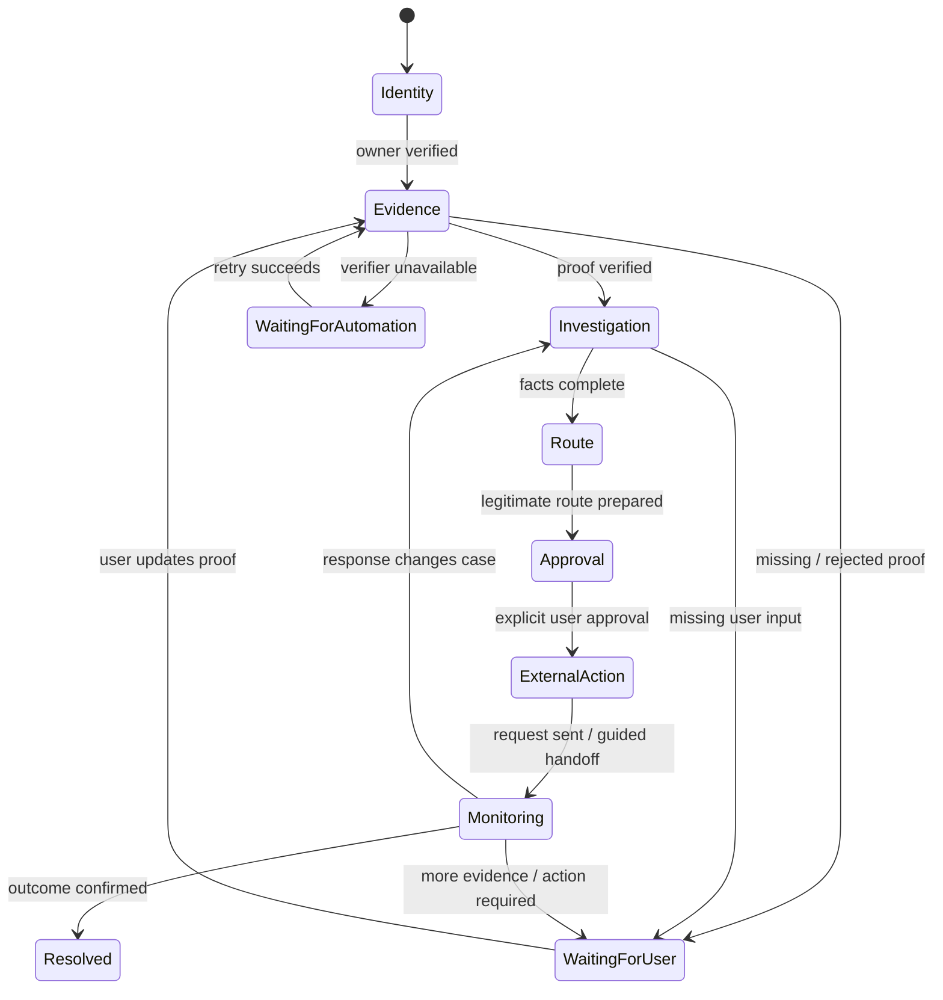
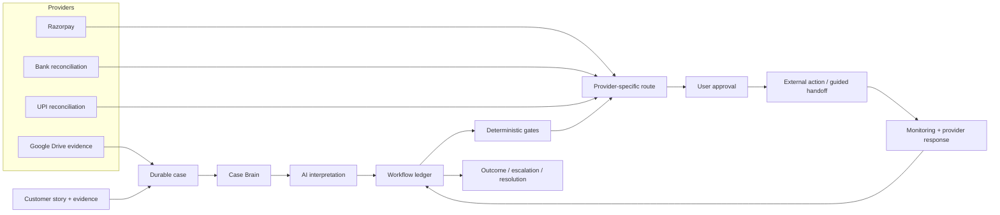

# RecoverIT

<p align="center">
  
</p>

<p align="center">
  <strong>AI revenue recovery for payment problems.</strong><br/>
  Turn a messy payment story into a verified, bounded, auditable recovery workflow.
</p>

<p align="center">
  <a href="https://recoverit.hatchable.site"><strong>Live product</strong></a> ·
  <a href="https://recoverit.hatchable.site/report.html"><strong>Try payment check</strong></a> ·
  <a href="./public/docs/DEMO.md"><strong>Demo guide</strong></a> ·
  <a href="./public/docs/ARCHITECTURE.md"><strong>Architecture</strong></a> ·
  <a href="./public/docs/EVALUATION.md"><strong>Evaluation</strong></a>
</p>

<p align="center">
  
  
  
  
</p>

> **Core thesis:** **AI interprets. Deterministic controls decide.**

---

## Why this repository exists

RecoverIT was built for the **Razorpay AI Buildathon 2026 — AI Revenue Recovery** track.

The problem is simple to describe and hard to automate safely: payment failures, missing refunds, duplicate charges and provider mismatches leave customers with fragmented evidence and no clear path to resolution.

RecoverIT treats the **recovery case** as the product primitive. A customer tells the system what happened once. RecoverIT keeps the evidence, payment facts, investigation, next action, approval state, provider response and outcome connected until the case reaches a useful endpoint.

This repository is deliberately organized so a reviewer can understand the product **before** reading the implementation and then trace each product claim back to code.

---

## 60-second judge path

If you are reviewing RecoverIT from scratch, this is the fastest path:

1. **See the product:** [Live RecoverIT](https://recoverit.hatchable.site)
2. **Try the low-friction entry point:** [Payment checker](https://recoverit.hatchable.site/report.html)
3. **Understand the core workflow:** [`WORKFLOW.md`](./public/docs/WORKFLOW.md)
4. **Understand the AI boundary:** [`AI-SAFETY.md`](./public/docs/AI-SAFETY.md)
5. **Trace the architecture:** [`ARCHITECTURE.md`](./public/docs/ARCHITECTURE.md)
6. **Read the failure story:** [`RELIABILITY.md`](./public/docs/RELIABILITY.md)
7. **Inspect reproducible validation:** [`EVALUATION.md`](./public/docs/EVALUATION.md)
8. **Open the core implementation:** `lib/case-workflow.js`, `lib/case-verification.js`, `lib/recoverit-ai.js`, `lib/case-brain.js`, `lib/dispute.js`

The hosted product is the canonical runnable environment; the repository is the source-level explanation of how the product works.

---

## Razorpay Buildathon fit

The Buildathon materials emphasize **problem taste, build quality, AI judgment and failure recovery**, with a public GitHub repository, a five-minute pitch video and an explanation of what broke and how it was fixed.

| Buildathon signal | What RecoverIT demonstrates |
|---|---|
| **Problem taste** | Payment/refund recovery is a real operational problem with money, evidence and multiple parties involved. |
| **Build quality** | Full-stack product, persistent Postgres state, provider integrations, background workers, idempotency/duplicate protection, notifications and test-mode validation. |
| **AI judgment** | AI handles interpretation and preparation; deterministic code owns authorization, money facts, routing, state transitions and resolution. |
| **Failure recovery** | Multimodal provider failover, retryable verification, durable workflow state, and a fix that decoupled evidence staging from temporary AI availability. |
| **Architecture** | Explicit state machine + workflow ledger + provider-specific routing + human approval gate. |
| **Working demo** | Public payment checker, full case flow and a synthetic Test Mode for the protected recovery path. |

**Important:** RecoverIT uses Razorpay **test-mode** payment integration for validation. It is not presented as an official Razorpay product, endorsement or production partnership.

---

## The product in one line

```text
REPORT → VERIFY → INVESTIGATE → RECOVER → APPROVE → MONITOR → RESOLVE
```

The key difference from a typical AI support bot is that this is a **durable workflow**. The browser can close. The next action remains persisted.

<p align="center">
  
</p>

---

## What problem does it solve?

Payment incidents rarely live in one system.

A customer may have:

- a bank debit,
- a merchant order,
- a gateway transaction,
- a refund reference,
- a screenshot or statement,
- and a provider response that says something different.

A support conversation can explain the situation, but it does not by itself reconcile the evidence or keep the case moving.

RecoverIT turns that fragmented story into a **case with memory, evidence, state and a next action**.

### Example

> “The merchant says my ₹18,500 refund was processed, but the money never reached my original payment account.”

RecoverIT can:

1. understand the natural-language story;
2. collect and interpret relevant evidence;
3. distinguish known facts from uncertainty;
4. reconstruct the payment/refund timeline;
5. select a legitimate recovery route;
6. prepare the exact external action;
7. stop for explicit user approval before consequential contact;
8. monitor the provider response;
9. request additional evidence if needed;
10. continue the same case until resolution or escalation.

---

## Why this is an AI product — and not just a chatbot

AI is useful because payment incidents contain **messy, unstructured information**.

### AI handles interpretation

- natural-language payment stories;
- multimodal document/evidence understanding;
- structured fact extraction;
- missing-information detection;
- provider-response interpretation;
- route/message preparation.

### Deterministic software handles authority

- identity and case ownership;
- payment/reference/amount consistency;
- evidence verification gates;
- destination and channel selection;
- state transitions;
- explicit approval;
- idempotency and duplicate protection;
- monitoring and retries;
- escalation eligibility;
- resolution confirmation.

> **AI can recommend the next step. It cannot authorize the consequential step.**

<p align="center">
  
</p>

This boundary is the central design decision in the product.

---

## The durable workflow

A RecoverIT case is a state machine, not a chat transcript.

<p align="center">
  
</p>



The workflow ledger persists:

```text
workflow_step
workflow_next_action
workflow_status
workflow_reason
workflow_last_trigger
workflow_updated_at
```

That means background jobs can reconcile an active case without reconstructing state from browser memory.

See [`WORKFLOW.md`](./public/docs/WORKFLOW.md) for the operating model.

---

## Evidence is a gate, not decoration

<p align="center">
  
</p>

Evidence moves through:

```text
UPLOAD
  ↓
MULTIMODAL ANALYSIS
  ↓
VERIFICATION
  ↓
STRUCTURED FACTS
  ↓
PAYMENT / TIMELINE RECONSTRUCTION
  ↓
LEGITIMATE ROUTE
```

The product distinguishes between:

- **VERIFIED** — evidence is sufficient for the relevant gate;
- **REVIEW** — evidence exists but should not authorize a consequential action;
- **REJECTED** — evidence is not acceptable for the requested purpose;
- **UNAVAILABLE / RETRYING** — the verifier failed temporarily and the case remains recoverable.

A temporary AI outage should not erase a user's evidence or force them to restart the case.

---

## Consequential actions are explicitly gated

A prepared recovery action is not automatically sent.

Before a consequential external action, RecoverIT checks the relevant evidence, payment facts, route and authorization state, then presents the exact action for approval.

```text
verified evidence
      +
consistent case facts
      +
legitimate destination / route
      +
prepared evidence bundle
      +
explicit user approval
      ↓
external action
```

If any required condition is missing, the action remains **prepared / blocked / waiting** instead of being guessed into existence.

The implementation boundary is visible in `api/cases/dispute-send.js`.

---

## Architecture



### Core implementation map

| Responsibility | Implementation |
|---|---|
| Durable workflow | `lib/case-workflow.js` |
| Evidence verification | `lib/case-verification.js` |
| AI provider abstraction / failover | `lib/recoverit-ai.js` |
| Case reasoning | `lib/case-brain.js` |
| Recovery route matrix | `lib/dispute.js` |
| Recovery follow-up automation | `lib/dispute-automation.js` |
| Resolution policy | `lib/resolution.js` |
| Consequential action gate | `api/cases/dispute-send.js` |
| Workflow state API | `api/cases/workflow-state.js` |
| Workflow advancement | `api/cases/workflow-advance.js` |
| Background continuation | `api/jobs/workflow-heartbeat.js` |
| Evidence upload | `api/evidence/upload.js` |
| Evidence analysis | `api/evidence/analyze.js` |
| Razorpay integration | `api/integrations/razorpay/*` |
| Bank reconciliation | `api/bank/reconcile.js` |
| UPI reconciliation | `api/upi/reconcile.js` |
| Notifications | `lib/user-notifications.js` |
| End-to-end validation | `api/test-mode/e2e.js`, `api/test-mode/recovery-suite.js` |

---

## AI provider strategy

RecoverIT does not assume one model endpoint is always healthy.

### Text tasks

The shared AI layer supports provider failover across:

```text
OpenRouter → Groq → Gemini → managed Sonnet
```

### Multimodal evidence

For images:

```text
Gemini → Groq → OpenRouter
```

For PDFs:

```text
Gemini → OpenRouter
```

The provider abstraction validates structured JSON output and records the provider used. A provider failure is treated as a recoverable infrastructure state rather than a reason to invent an answer.

The implementation is in [`lib/recoverit-ai.js`](./lib/recoverit-ai.js).

---

## What broke — and how it was fixed

This is intentionally documented because failure recovery is part of the product quality.

### Failure 1 — document verification timed out

The first evidence preflight performed multimodal verification synchronously. A slow provider could hit the request timeout and return a `502`, which made the whole case-creation flow feel broken even though the evidence had already been uploaded.

**Fix:** evidence staging and verification were separated. The proof is retained, the case can enter a review/unverified path, and verification can continue/retry in the background. Consequential actions remain fail-closed until verification succeeds.

### Failure 2 — structured JSON was cut off by model reasoning budget

A multimodal model configuration could spend too much of its output budget on internal reasoning and return incomplete structured JSON.

**Fix:** the document-analysis request now uses a concise schema-oriented prompt, JSON response mode where supported, bounded output, and minimal thinking configuration for that provider.

### Failure 3 — one provider could not reliably handle every document path

PDF and image capabilities differed across providers.

**Fix:** the multimodal adapter uses modality-aware fallback order rather than pretending every provider has identical capabilities.

### Failure 4 — a transient verifier outage caused repeated user frustration

The UI could previously expose retry/upload states too aggressively and re-render the case surface while polling.

**Fix:** verification state is preserved, retry behavior is durable, upload controls only appear when actually needed, and live case state is updated without replacing the entire page.

### Engineering lesson

> **A model failure should become a workflow state — not a lost case.**

See [`RELIABILITY.md`](./public/docs/RELIABILITY.md) for the broader failure model.

---

## Reliability invariants

RecoverIT is designed around explicit invariants:

1. **No verified evidence → no consequential external contact.**
2. **No legitimate route → no send.**
3. **No explicit user approval → no consequential action.**
4. **Provider processing alone does not equal customer receipt.**
5. **Duplicate matching money-related actions are blocked.**
6. **Temporary AI/provider failure preserves case state and enables retry.**
7. **External responses re-enter the same case workflow.**
8. **Uncertainty is represented explicitly instead of being guessed away.**

---

## Validation and test evidence

The repository includes a synthetic end-to-end harness that exercises the real workflow components rather than a disconnected mock architecture.

### Latest recorded full E2E run

**21/21 checks passed** on **September 2, 2026**.

The recorded run verified:

- database/schema reachability;
- synthetic case creation;
- verified evidence fixture shape;
- **13 eligible recovery routes**;
- first recovery action preparation;
- persisted action attempt;
- transition into an awaiting-response state;
- organization response capture;
- requested-document tracking;
- replacement evidence satisfying the exact requirement;
- same-organization follow-up;
- same-case continuity;
- approval requirement;
- resolution-state synchronization;
- multimodal AI provider availability.

The latest run's multimodal probe succeeded through the provider fallback path with **OpenRouter**. This is evidence that the failover path is exercised; it is not a claim that one specific provider is always available.

### Additional recovery-suite evidence

The broader recovery suite currently covers:

- five high-value issue types;
- no-evidence contact blocking;
- missing-document gating;
- verified first-action preparation;
- same-organization follow-up;
- escalation preparation;
- Case Brain reconstruction;
- resolution projection;
- a connected Razorpay test payment probe.

The repository records the actual test result instead of publishing invented recovery-rate percentages.

For the Buildathon-specific reviewer map, see [`BUILDATHON.md`](./public/docs/BUILDATHON.md).

<p align="center">
  
</p>

> **Test-mode amounts are synthetic.** The repository does not claim that ₹100 or ₹500 represents real customer funds recovered.

See [`EVALUATION.md`](./public/docs/EVALUATION.md) for the evaluation boundary.

---

## Integrations

| Integration | Current role |
|---|---|
| **Razorpay** | Test-mode payment/refund probes and payment-state integration foundation. |
| **Bank reconciliation** | Payment evidence and bank-side reconciliation path. |
| **UPI reconciliation** | UPI-specific payment context and routing foundation. |
| **Google Drive** | Optional evidence import path. This is **not** Google sign-in. |
| **Email** | Transactional case notifications and action-needed updates. |
| **Twilio SMS** | Important/action-needed SMS channel; WhatsApp is intentionally not part of the current product. |

Secrets and production credentials are not committed.

See [`INTEGRATIONS.md`](./public/docs/INTEGRATIONS.md).

---

## Test Mode

RecoverIT includes a dedicated synthetic scenario so the protected recovery path can be inspected without contacting a real organization.

**Scenario:**

```text
synthetic payment completed
        ↓
refund initiated
        ↓
conflicting information
        ↓
duplicate recovery attempt
        ↓
RecoverIT protection / Action Ledger
```

Open [`/test-mode.html`](https://recoverit.hatchable.site/test-mode.html) in the hosted app after signing in.

The scenario is explicitly labeled synthetic and the test harness never treats synthetic fixtures as real customer recovery claims.

---

## Data model at a glance

The durable state is distributed across purpose-specific Postgres tables rather than stored inside an LLM transcript.

```text
recovery_cases
├── evidence
│   └── evidence_analysis
├── case_brain
├── case_payment_context
├── financial_transactions
├── payment_monitors
├── dispute_state
│   ├── dispute_attempts
│   ├── dispute_requirements
│   └── dispute_responses
├── case_resolution_state
├── action_executions
├── notifications
└── outcome / feedback signals
```

This separation makes it possible to retry interpretation, update provider state, satisfy a document requirement, or resume a case without replaying an entire conversation.

---

## Repository structure

```text
RecoverIT/
├── README.md                         # reviewer-first entry point
├── hatchable.toml                    # runtime/auth/AI/provider configuration
├── api/
│   ├── cases/                        # case lifecycle, reasoning, disputes, workflow
│   ├── evidence/                     # upload + analysis
│   ├── integrations/                 # Razorpay, Drive, health
│   ├── jobs/                         # background verification/monitoring/workflow
│   ├── bank/ + upi/                  # reconciliation
│   ├── notifications/                # in-app notification APIs
│   └── test-mode/                    # synthetic validation harness
├── lib/
│   ├── case-workflow.js              # authoritative workflow engine
│   ├── case-verification.js          # evidence verification
│   ├── recoverit-ai.js               # AI provider abstraction/failover
│   ├── case-brain.js                 # structured case reasoning
│   ├── dispute.js                    # route selection + recovery logic
│   ├── dispute-automation.js         # follow-ups
│   ├── resolution.js                 # resolution policy
│   └── user-notifications.js         # deduplicated notification delivery
├── migrations/                       # ordered PostgreSQL schema evolution
├── public/
│   ├── index.html                    # product landing page
│   ├── report.html                   # payment-check / case entry
│   ├── case.html                     # live case surface
│   ├── test-mode.html                # synthetic demo
│   ├── assets/                       # architecture/workflow visuals
│   └── docs/                         # technical due-diligence docs
└── pages/
    └── share/[token].js              # shareable case surface
```

GitHub supports relative README links and images, so the repository's technical documentation remains navigable directly from the root README. citeturn4search0turn4search1

---

## How to inspect the implementation

Start with these files in order:

```text
1. lib/case-workflow.js
2. lib/case-verification.js
3. lib/recoverit-ai.js
4. lib/case-brain.js
5. lib/dispute.js
6. api/cases/dispute-send.js
7. api/jobs/workflow-heartbeat.js
8. api/test-mode/e2e.js
```

Useful source-level checks:

```bash
grep -n "advanceCaseWorkflow" lib/case-workflow.js
grep -n "analyzeDocument" lib/case-verification.js
grep -n "USER_APPROVED" api/cases/dispute-send.js
grep -n "workflow_next_action" migrations/064_02_workflow_status.sql migrations/064_03_workflow_reason.sql
```

### Runtime note

RecoverIT is deployed on Hatchable. The platform provides the serverless runtime, PostgreSQL, authentication, storage, scheduling, managed AI gateway and email primitives used by the application. There is no conventional local Node build step in this repository.

That is intentional: the source tree is the deployed application, while provider credentials remain outside the repository.

---

## Technical documentation

| Document | What a reviewer learns |
|---|---|
| [`PRODUCT.md`](./public/docs/PRODUCT.md) | Product thesis and customer problem |
| [`ARCHITECTURE.md`](./public/docs/ARCHITECTURE.md) | System boundaries and component responsibilities |
| [`WORKFLOW.md`](./public/docs/WORKFLOW.md) | Durable state machine and continuation model |
| [`AI-SAFETY.md`](./public/docs/AI-SAFETY.md) | Where AI is used and where it is deliberately not used |
| [`RELIABILITY.md`](./public/docs/RELIABILITY.md) | Failure modes, retries and fail-closed behavior |
| [`EVALUATION.md`](./public/docs/EVALUATION.md) | Test methodology and evidence boundaries |
| [`INTEGRATIONS.md`](./public/docs/INTEGRATIONS.md) | Provider and evidence integrations |
| [`SCALABILITY.md`](./public/docs/SCALABILITY.md) | Path from one case to a recovery network |
| [`SECURITY.md`](./public/docs/SECURITY.md) | Auth, secrets, evidence and action safety |
| [`DEMO.md`](./public/docs/DEMO.md) | Recommended judge walkthrough |
| [`BUILDATHON.md`](./public/docs/BUILDATHON.md) | Razorpay submission mapping and reviewer checklist |

---

## Product → company thesis

<p align="center">
  
</p>

The product starts with one payment problem, but the underlying data model supports a larger network:

```text
more payment contexts
        ↓
more legitimate provider routes
        ↓
more cases
        ↓
more outcome data
        ↓
better recovery playbooks
        ↓
more useful automation
```

The long-term opportunity is not “another support chatbot.” It is a **payment-resolution layer** that makes fragmented recovery work executable, measurable and continuously improving while preserving the deterministic safety boundary.

See [`SCALABILITY.md`](./public/docs/SCALABILITY.md).

---

## What RecoverIT deliberately does not claim

Credibility matters more than inflated metrics.

RecoverIT does **not** claim:

- a production-scale recovery percentage;
- real customer money recovered from the synthetic test amounts;
- universal provider coverage;
- that AI independently makes financial decisions;
- that provider processing means a customer has received funds;
- official Razorpay endorsement or production partnership.

Where a number appears in the repository, it is labeled as a test result, synthetic fixture or current implementation capability.

---

## Security and privacy posture

- End-user authentication is handled by the platform auth layer.
- Case data is scoped to the authenticated user.
- Secrets and provider credentials stay server-side.
- Private evidence is stored outside the public repository.
- Consequential recovery actions require verified evidence and explicit approval.
- Synthetic Test Mode is isolated conceptually and clearly labeled.
- Production claims are intended to be backed by provider evidence, not model output alone.

See [`SECURITY.md`](./public/docs/SECURITY.md) and [`AI-SAFETY.md`](./public/docs/AI-SAFETY.md).

---

## Current status

**Active early-stage product build.**

The hosted product has a working full-stack recovery workflow, connected provider/test infrastructure, persistent workflow state, multimodal evidence analysis, notifications and a reproducible synthetic validation harness.

The architecture is designed as a foundation for production, but production-scale financial performance still needs a larger labeled evaluation set and real operational traffic.

> **Start with one payment problem. Build the system that can stay with it until the money has an outcome.**

---

## License

See [`public/LICENSE`](./public/LICENSE).