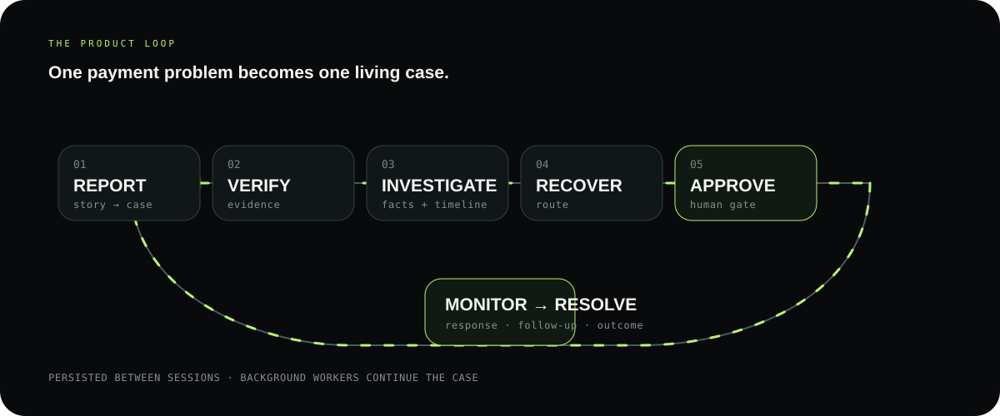
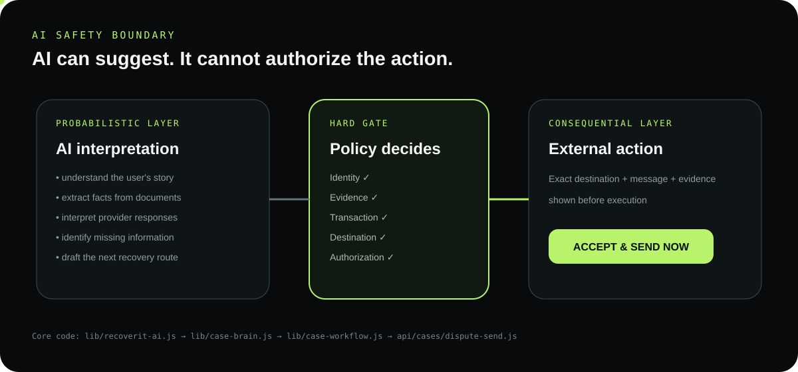
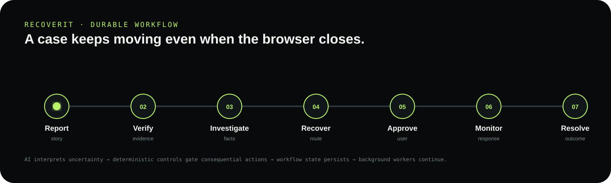
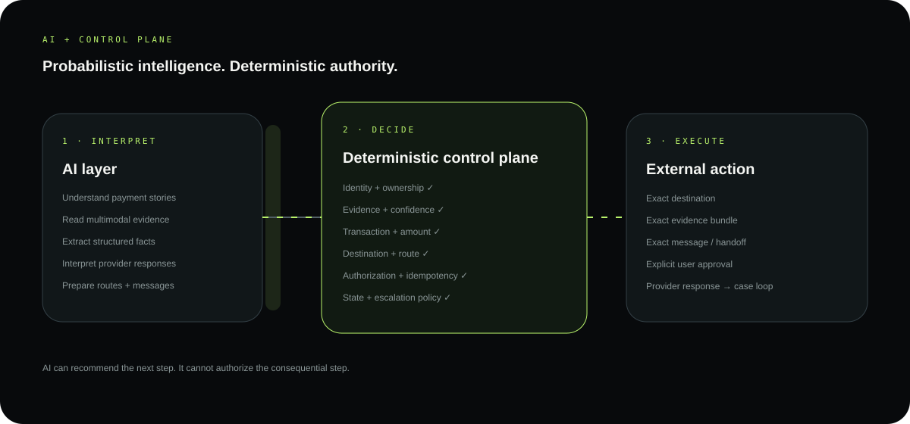

# RecoverIT

<p align="center">
  
</p>

<p align="center">
  <strong>AI-powered payment recovery.</strong><br>
  Turn a messy payment problem into a verified, auditable case that stays active until there is an outcome.
</p>

<p align="center">
  <a href="https://recoverit.hatchable.site"><strong>Live product</strong></a> ·
  <a href="https://recoverit.hatchable.site/report.html"><strong>Try it</strong></a> ·
  <a href="./public/docs/DEMO.md"><strong>Demo</strong></a> ·
  <a href="./public/docs/ARCHITECTURE.md"><strong>Architecture</strong></a> ·
  <a href="./public/docs/WORKFLOW.md"><strong>Workflow</strong></a>
</p>

> **AI interprets the messy parts. Deterministic software controls the consequential parts.**

---

## The problem

A payment problem rarely lives in one place. A customer may have a bank debit, merchant order, gateway reference, refund message and receipt — while each system exposes only part of the story.

RecoverIT turns those fragments into **one durable recovery case** instead of another disconnected support conversation.

## The complete loop

```text
REPORT
  ↓
EVIDENCE
  ↓
VERIFY
  ↓
INVESTIGATE
  ↓
RECOVERY ROUTE
  ↓
USER APPROVAL
  ↓
EXTERNAL ACTION / HANDOFF
  ↓
MONITOR
  ↓
RESOLVE / ESCALATE / REQUEST INPUT
```

<p align="center">
  
</p>

The important idea is that **the case is the product, not the chat**. If a user closes the browser or a provider responds later, the workflow still knows where it is and what happens next.

---

## What actually happens inside a case

**1. Report** — the customer describes the payment problem naturally.

**2. Evidence** — receipts, statements, screenshots or PDFs become structured case evidence.

**3. Verify** — multimodal AI interprets the evidence, while application rules decide whether it satisfies the relevant gate.

**4. Investigate** — payment facts, evidence and timeline are reconciled into a structured case view.

**5. Recover** — the system selects a legitimate recovery path from the available provider/payment context.

**6. Approve** — consequential contact is prepared with the exact destination, channel, message and evidence, then requires explicit user approval.

**7. Monitor** — provider responses, refund/payment state and new requirements return to the same case.

**8. Resolve** — the case closes only when the relevant outcome is actually supported; otherwise it waits or escalates.

---

## AI where it helps. Rules where money is involved.

<p align="center">
  
</p>

### AI handles ambiguity

- natural-language payment stories
- multimodal evidence interpretation
- structured fact extraction
- missing-information detection
- provider-response interpretation
- recovery/message preparation

### Deterministic software handles authority

- authentication and case ownership
- exact payment/reference/amount facts
- evidence gates
- legitimate destination and route
- workflow transitions
- explicit approval
- duplicate/idempotency protection
- retries and monitoring
- escalation and resolution rules

**A model can recommend a next step. It cannot authorize a consequential step.**

See [`AI-SAFETY.md`](./public/docs/AI-SAFETY.md).

---

## Durable workflow

A case is persisted as a state machine rather than reconstructed from conversation history.

<p align="center">
  
</p>

The loop is simple to read: **evidence can wait, verification can retry, provider responses can return later, and resolution is only reached when the outcome is supported.**

```text
CASE STATE → NEXT ACTION → REASON → TRIGGER → CONTINUE
```

Background workers keep the case moving without an open browser. See [`WORKFLOW.md`](./public/docs/WORKFLOW.md) for the full state machine and transitions.

---

## Evidence is a control, not an attachment

```text
UPLOAD
  ↓
MULTIMODAL ANALYSIS
  ↓
VERIFICATION
  ↓
STRUCTURED FACTS
  ↓
PAYMENT / TIMELINE RECONCILIATION
  ↓
ROUTE ELIGIBILITY
```

RecoverIT distinguishes **VERIFIED**, **REVIEW**, **REJECTED**, and **temporarily UNAVAILABLE / RETRYING** states.

That distinction matters: a verifier outage should not delete the customer's evidence, while uncertain evidence must never silently unlock a financial action.

---

## The failure that changed the architecture

The first evidence-preflight design made synchronous multimodal verification part of case creation. When a model/provider timed out, the whole case could appear to fail even though the evidence had already been uploaded.

The fix was architectural:

```text
Evidence staging  ≠  Evidence authorization

upload evidence
      ↓
preserve case
      ↓
retry / fail over verification
      ↓
reconcile workflow
      ↓
unlock only after the relevant gate passes
```

A temporary AI failure is now a **recoverable workflow state**, not a lost case.

See [`RELIABILITY.md`](./public/docs/RELIABILITY.md).

---

## Architecture at a glance

<p align="center">
  
</p>

The architecture has three clear boundaries:

```text
AI INTERPRETATION  →  DETERMINISTIC CONTROL PLANE  →  EXTERNAL ACTION
 stories/evidence      identity · evidence · route      approved handoff
 facts/responses      state · policy · idempotency     provider response
```

### Core implementation

| Layer | Code |
|---|---|
| Workflow engine | `lib/case-workflow.js` |
| Evidence verification | `lib/case-verification.js` |
| AI abstraction / failover | `lib/recoverit-ai.js` |
| Structured case reasoning | `lib/case-brain.js` |
| Recovery routes | `lib/dispute.js` |
| Follow-up automation | `lib/dispute-automation.js` |
| Resolution policy | `lib/resolution.js` |
| Consequential-action gate | `api/cases/dispute-send.js` |
| Background continuation | `api/jobs/workflow-heartbeat.js` |
| Provider integrations | `api/integrations/` |
| E2E validation | `api/test-mode/` |

---

## Validation

The repository includes a synthetic end-to-end harness that exercises the actual workflow contracts.

**Latest recorded full run: 21/21 checks passed — September 2, 2026.**

It covered the case lifecycle, evidence contract, **13 eligible recovery routes**, action preparation, response handling, requested-document satisfaction, same-case follow-up, approval enforcement, resolution synchronization and multimodal AI availability/fallback.

These are engineering/test results — **not** a claim of production recovery rate or real customer money recovered.

See [`EVALUATION.md`](./public/docs/EVALUATION.md).

---

## Integrations

- **Razorpay test mode** — payment/refund probes and payment-state integration
- **Bank reconciliation** — bank-side payment context
- **UPI reconciliation** — UPI-specific context
- **Google Drive** — optional evidence import
- **Email** — meaningful case/action-needed notifications
- **Twilio SMS** — important/action-needed notifications

Provider integrations feed the case; they do not bypass the workflow's evidence, policy or approval gates.

---

## Test Mode

A protected synthetic scenario lets reviewers inspect the recovery path without contacting a real organization:

```text
synthetic payment
      ↓
refund initiated
      ↓
conflicting information
      ↓
duplicate recovery attempt
      ↓
protection + Action Ledger
```

Open [`Test Mode`](https://recoverit.hatchable.site/test-mode.html) after signing in.

---

## Technology

**JavaScript · HTML/CSS · PostgreSQL · multimodal AI · object storage · passwordless authentication · scheduled workers · Razorpay test integration · email · Twilio SMS**

Provider credentials and private evidence stay outside source control.

---

## Go deeper

| Read | Why |
|---|---|
| [`PRODUCT.md`](./public/docs/PRODUCT.md) | Product model |
| [`WORKFLOW.md`](./public/docs/WORKFLOW.md) | Durable case lifecycle |
| [`AI-SAFETY.md`](./public/docs/AI-SAFETY.md) | AI vs deterministic authority |
| [`ARCHITECTURE.md`](./public/docs/ARCHITECTURE.md) | System design |
| [`RELIABILITY.md`](./public/docs/RELIABILITY.md) | Failure and recovery model |
| [`EVALUATION.md`](./public/docs/EVALUATION.md) | Test methodology |
| [`INTEGRATIONS.md`](./public/docs/INTEGRATIONS.md) | Provider boundaries |
| [`SCALABILITY.md`](./public/docs/SCALABILITY.md) | Product expansion |
| [`SECURITY.md`](./public/docs/SECURITY.md) | Security/privacy posture |
| [`DEMO.md`](./public/docs/DEMO.md) | Five-minute walkthrough |

---

## Product direction

RecoverIT starts with one unresolved payment and builds toward a broader **payment-resolution layer**: more payment contexts → more provider routes → more outcome data → better recovery playbooks → safer automation.

The core principle stays the same:

> **Don't just explain what happened to the payment. Stay with the payment until there is an outcome.**

---

## Current boundary

RecoverIT is an early-stage product build. The current evidence demonstrates a connected workflow, safety gates, provider integrations and reproducible test behavior. Production-scale recovery metrics and broader real-world provider coverage still require larger operational datasets.

Synthetic data is explicitly labeled as synthetic; the project does not present test results as customer-money recovery claims.

---

## License

See [`public/LICENSE`](./public/LICENSE).