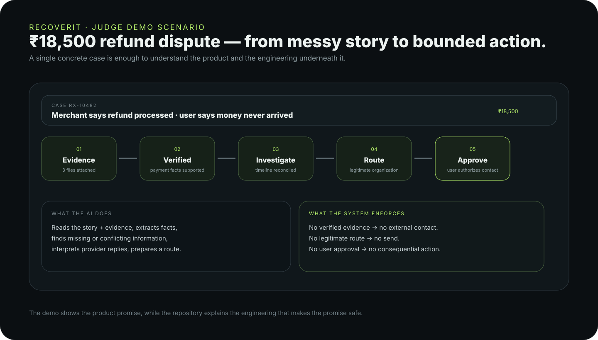
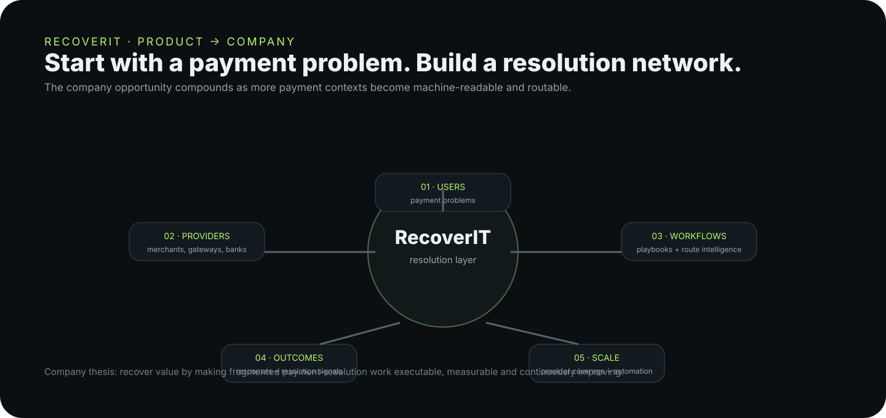

# RecoverIT

> ## AI revenue recovery, from messy payment story to verified action.
>
> RecoverIT is being built as a **payment-resolution layer**: it turns fragmented payment evidence into a persistent case, determines the next legitimate recovery step, asks the user before consequential action, and keeps the workflow moving until there is an outcome.

[](https://recoverit.hatchable.site)
[](https://hatchable.ai)
[](https://ai.google.dev/)
[](./public/assets/recoverit-workflow.svg)

### Start here

**Live product:** https://recoverit.hatchable.site  ·  **Repository thesis:** AI interprets; deterministic controls decide.



> **The product loop:** report → understand → verify → investigate → route → user approval → recover → monitor → resolve.

---

## What RecoverIT is becoming

RecoverIT should not feel like a complaint form with an AI chatbot attached. The long-term product is a **resolution system for money problems** where the unit of work is a durable case, not a conversation.

```text
Payment problem
      ↓
Persistent case
      ↓
Evidence + payment facts
      ↓
AI interpretation
      ↓
Deterministic safety gates
      ↓
Legitimate recovery route
      ↓
Explicit user approval
      ↓
External action / guided handoff
      ↓
Provider response + monitoring
      ↓
Recovery / escalation / resolution
```

The company opportunity is to make fragmented payment-resolution work **executable, measurable and increasingly routable** across merchants, gateways, banks, UPI and other payment contexts. The current build is an early product foundation; scale claims beyond the demonstrated system are intentionally treated as roadmap, not as already-achieved production volume.



### Why this matters

Payment support is fragmented across the user, merchant, payment gateway, bank, UPI rail, refund system and support queue. RecoverIT's product thesis is that the missing layer is not another place to file a complaint. It is a system that can **reconstruct the case, preserve state, select a legitimate next step, execute only within explicit bounds, and remain on the thread until the outcome is confirmed**.

---

## Why RecoverIT?

Payment disputes are rarely as simple as "raise a complaint." A user may know that money was deducted, a refund was promised, or a transaction failed, but still have no idea:

- what actually happened;
- which evidence matters;
- who needs to be contacted;
- what to do next;
- whether they should wait or escalate; or
- whether the issue has genuinely been resolved.

RecoverIT is built around a different model:

```text
User story
    ↓
Understand the problem
    ↓
Verify identity + payment facts
    ↓
Collect and review evidence
    ↓
Investigate
    ↓
Give one clear next action
    ↓
Monitor the case
    ↓
Notify the user when something changes
    ↓
Escalate when appropriate
    ↓
Confirm the real outcome
```

The goal is not to generate a generic complaint and leave the user alone. The goal is to create a **living case** that can continue moving toward a real outcome.

---

## Product principles

### 1. Outcome over AI

The user does not care that an AI model ran an inference. They care about what happened to their money and what they should do next.

RecoverIT therefore keeps AI behind the product experience and exposes useful outcomes such as:

- **Payment verified**
- **Evidence needed**
- **Provider response received**
- **Evidence conflict found**
- **Action required**
- **Waiting for provider**
- **Escalation prepared**
- **Resolved**

### 2. AI where judgment helps; deterministic systems where certainty matters

RecoverIT deliberately does **not** use AI for everything.

**AI is useful for:**

- understanding natural-language payment stories;
- extracting structured facts from messy descriptions;
- interpreting provider responses;
- reviewing evidence context;
- identifying missing information;
- explaining complicated payment journeys in simple language;
- preparing provider-specific messages and escalation drafts;
- multilingual and voice-based interaction.

**Deterministic logic is preferred for:**

- authentication and authorization;
- case ownership;
- transaction/reference data;
- timestamps and amounts;
- case states;
- evidence presence;
- monitoring schedules;
- notification delivery;
- escalation eligibility rules;
- resolution confirmation;
- database integrity.

This separation is intentional: AI should help reason about uncertainty, not invent payment states.

### 3. Never assume a payment state without reliable evidence

If an AI provider is unavailable or evidence is incomplete, RecoverIT should preserve uncertainty rather than manufacture an answer.

For example:

> "We could not verify the refund yet. The case remains open and needs additional evidence."

is preferable to an unsupported claim that a refund was or was not received.

---

## Core capabilities

### 🧾 Case registration

Users can describe a payment problem using natural language instead of having to understand financial terminology first.

The system supports:

- text descriptions;
- voice-based reporting;
- transaction/reference information;
- provider or merchant responses;
- evidence uploads.

### 🔎 AI-assisted investigation

RecoverIT can turn a user's story and available evidence into structured investigation context and explain what is known, unknown, and required next.

### 🧩 Evidence management

Users can provide supporting material such as:

- receipts;
- bank statements;
- refund confirmations;
- screenshots;
- provider responses;
- payment references;
- other relevant proof.

### 🛡️ Identity verification

Cases are tied to the authenticated user account so investigation and case history can continue without repeatedly asking the user to identify themselves.

### 🧠 Resolution engine

Cases are treated as living resolution workflows rather than static complaint forms.

A case can move through stages such as:

```text
Understand
→ Verify
→ Check proof
→ Investigate
→ Recovery plan
→ User action / Provider waiting
→ Monitor
→ Resolve
```

### 🔄 Continuous monitoring

Active cases can be checked by background jobs. RecoverIT can surface meaningful changes and determine when the user needs to pay attention.

The system is designed around **meaningful updates**, not noisy "AI is thinking" notifications.

### 🔔 User notifications

When a case requires attention or receives a meaningful update, RecoverIT can surface the update through the product's notification and email-update workflows.

Examples:

> **Action needed:** Add the transaction reference so the investigation can continue.

or:

> **New provider response:** RecoverIT found a discrepancy between the response and the evidence you supplied.

### 🏦 Provider intelligence

RecoverIT includes provider-oriented workflows and intelligence designed to make investigations more specific to the payment ecosystem involved.

The architecture can be extended with provider playbooks for UPI, wallets, cards, banks, merchants, payment gateways, telecom services, and other payment contexts.

### 📦 Dispute Pack

RecoverIT can prepare a structured escalation package containing relevant case facts, evidence, timeline, provider responses, and the requested resolution.

The user remains in control of consequential escalation actions.

### 📈 Outcome learning

User feedback and case outcomes are captured as product signals so future versions can learn which workflows, questions, evidence requests, and resolution paths are actually useful.

The objective is to optimize for **real resolution**, not simply more AI activity.

### 🛡️ Payment Protection

RecoverIT includes a foundation for personal payment/refund monitoring so users can keep track of active payment issues and return to cases that need attention.

---

## Architecture

RecoverIT is currently implemented as a full-stack web application on Hatchable.

```text
                         ┌─────────────────────┐
                         │   RecoverIT Web UI   │
                         │ Landing / Dashboard │
                         │ Case / Evidence     │
                         └──────────┬──────────┘
                                    │
                         authenticated API calls
                                    │
             ┌──────────────────────┴──────────────────────┐
             │                                             │
     ┌───────▼────────┐                           ┌────────▼────────┐
     │ Case workflows │                           │ User services   │
     │ Investigation  │                           │ Notifications   │
     │ Evidence       │                           │ Feedback        │
     │ Resolution     │                           │ Verification    │
     └───────┬────────┘                           └────────┬────────┘
             │                                             │
             └──────────────────┬──────────────────────────┘
                                │
                       ┌────────▼─────────┐
                       │ PostgreSQL / DB  │
                       │ Cases / Events   │
                       │ Evidence / Data  │
                       │ Workflow position│
                       │ + next action    │
                       └────────┬─────────┘
                                │
                 ┌──────────────┴──────────────┐
                 │                             │
        ┌────────▼────────┐           ┌────────▼────────┐
        │ AI reasoning    │           │ Background jobs │
        │ Gemini via      │           │ Case monitoring │
        │ Hatchable AI    │           │ Payment monitor │
        └─────────────────┘           └─────────────────┘
```

### Backend areas

The current project includes API areas for:

- account information;
- case creation and retrieval;
- investigation and AI reports;
- live/quick case status;
- evidence upload;
- identity verification;
- notifications;
- payment checks and complaint preparation;
- provider intelligence;
- feedback and outcome signals;
- P1/P2 case tooling;
- resolution state and durable workflow position;
- evidence verification and AI-provider failover;
- dispute planning, approval, response handling, and escalation;
- Razorpay transaction/refund and webhook handling;
- Google Drive evidence import;
- scheduled case, verification, payment, dispute, and workflow monitoring;
- end-to-end recovery test scenarios.

### Data model

The project uses PostgreSQL migrations for its application data, including case, event, investigation, evidence, notification, feedback, provider, monitoring, analytics, escalation, and resolution functionality.

Migrations are versioned in `migrations/` and applied by Hatchable during deployment.

---

## AI architecture

RecoverIT uses AI as a reasoning layer rather than as the system of record.

A simplified investigation looks like:

```text
Natural-language story
        │
        ▼
Fact extraction
        │
        ├── amount
        ├── date/time
        ├── provider
        ├── transaction reference
        ├── claimed outcome
        └── missing information
        │
        ▼
Evidence + provider context
        │
        ▼
AI reasoning
        │
        ├── what is supported?
        ├── what is uncertain?
        ├── what conflicts?
        └── what information is needed?
        │
        ▼
Deterministic resolution state
        │
        ▼
One clear user action
```

This design is important for trust. An AI response is treated as an input to the resolution workflow, not unquestionable truth.

---

## Continuous investigation

RecoverIT is designed for cases that take time.

A case can remain active while waiting for:

- provider responses;
- additional evidence;
- refund processing;
- payment-state changes;
- user confirmation;
- escalation windows.

Background monitoring runs independently of the user's browser session. Users should not need to keep a page open for a case to remain active.

The case monitor operates on active cases in batches, allowing the architecture to scale beyond a single user's case.

---

## Privacy & security

Payment disputes can contain highly sensitive information. RecoverIT is therefore designed around several principles:

- authentication is handled by the platform;
- case access is scoped to the authenticated user;
- API endpoints declare access requirements;
- secrets are stored through Hatchable's secret configuration rather than committed credentials;
- provider webhook secrets are kept server-side;
- AI credentials are not exposed to the browser;
- evidence should only be accessed by authorized workflows;
- consequential escalation actions should remain user-controlled.

### Important

**Never commit real API keys, webhook secrets, credentials, private certificates, customer evidence, production database exports, or other sensitive material to a public GitHub repository.**

Before making this repository public, review the repository contents and Git history for secrets and personal data.

---

## Configuration

RecoverIT uses Hatchable configuration and managed services.

The current production configuration includes passwordless authentication, Google-backed AI with provider failover, evidence verification, scheduled case/workflow monitoring, Razorpay transaction/refund hooks, Twilio messaging configuration, and optional Google Drive / Account Aggregator integration settings.

Secrets are configured through the deployment environment rather than hard-coded into application source.

Typical configuration concepts include:

```toml
[auth]
enabled = true

[ai]
required = true

# Runtime/provider settings and secrets are configured in Hatchable; do not
# copy real credentials into this repository.

[[secret]]
key = "GOOGLE_API_KEY"
required = true
expose = false
```

Do **not** put actual secret values into `hatchable.toml` or GitHub.

---

## Local / development notes

The project is built for Hatchable's managed runtime.

Hatchable provides the runtime services used by RecoverIT, including:

- PostgreSQL access;
- authentication;
- AI access;
- storage;
- email;
- scheduling;
- browser capabilities;
- deployment and API hosting.

The project intentionally uses the Hatchable SDK instead of maintaining duplicate infrastructure clients.

If you are developing this project outside Hatchable, you will need to provide equivalents for those managed services or adapt the application architecture accordingly.

---

## Repository map

```text
.
├── README.md
├── hatchable.toml
├── api/
│   ├── cases/                 # case lifecycle, investigation, dispute, workflow
│   ├── evidence/              # upload + analysis + verification
│   ├── integrations/          # Razorpay, Google Drive and provider integrations
│   ├── jobs/                  # background continuation and monitoring
│   ├── payment/               # payment checks and verification
│   ├── webhooks/              # provider/external response entry points
│   └── ...
├── lib/
│   ├── case-workflow.js       # authoritative workflow engine
│   ├── case-verification.js   # evidence verification + retries
│   ├── case-brain.js          # case reasoning/presentation
│   ├── recoverit-ai.js        # AI provider abstraction + failover
│   ├── dispute.js             # route and dispute logic
│   ├── dispute-automation.js  # continuing external workflow
│   ├── resolution.js          # resolution/outcome logic
│   └── integrations.js        # provider integration helpers
├── migrations/                # 001 → 065 versioned PostgreSQL schema
├── public/
│   ├── index.html             # public product experience
│   ├── app.html               # authenticated workspace
│   ├── case.html              # live recovery case
│   ├── report.html            # case creation/readiness
│   ├── resolution.html        # resolution surface
│   ├── assets/                # architecture + judge-demo visuals
│   ├── docs/                  # architecture, workflow, safety, reliability
│   ├── cases/                 # problem-specific visual assets
│   └── ...
└── pages/
    └── share/[token].js       # secure case-share surface
```

### Product-to-code map

| Product promise | Implementation |
|---|---|
| Persistent case state | `lib/case-workflow.js` + `recovery_cases.workflow_*` |
| Evidence verification | `lib/case-verification.js` + `api/evidence/*` |
| AI interpretation | `lib/recoverit-ai.js` + `lib/case-brain.js` |
| Safe external recovery | `lib/dispute.js` + `api/cases/dispute-*` |
| Background continuation | `api/jobs/workflow-heartbeat.js` + scheduled workers |
| Provider integration | `api/integrations/*` + provider directory |
| Outcome / resolution | `lib/resolution.js` + `api/cases/resolution-state.js` |
| End-to-end verification | `api/test-mode/e2e.js` + recovery suite |

---

## Workflow durability

RecoverIT persists the current position of every active case instead of deriving the UI state from the latest browser session. The workflow ledger records:

- the current workflow step;
- the exact next action;
- whether the case is active, waiting for the user, waiting for automation, or done;
- the reason for the current state;
- the trigger that last advanced the workflow;
- when that workflow position was last reconciled.

A central workflow engine reconciles this state after case creation, evidence verification, investigation progress, provider responses, outbound contact, and on a recurring heartbeat. Opening a case therefore resumes from its persisted position rather than restarting the process.

This is a core reliability property of the product: **the case state is durable; the AI is not the source of truth.**

---

## Evaluation and testability

The repository includes test-mode endpoints for deterministic end-to-end recovery scenarios, duplicate-action protection, external-response loops, AI-provider probing, and integration checks. The main E2E harness is designed to verify the complete chain rather than only individual functions.

The latest recorded full E2E run before the workflow-ledger changes passed **21/21 checks**. Test fixtures use synthetic data and `*.invalid` destinations; no real customer evidence or production payment credentials belong in the repository.

For the Razorpay buildathon, the important outcome metrics are intended to be measured from a reproducible evaluation set rather than estimated from product activity: recovery-route accuracy, evidence-verification accuracy, successful recovery rate, amount recovered, and abstention/exception rate.

---

## Product → company

RecoverIT is designed to grow from a single recovery case into a reusable payment-resolution platform. The product surface stays focused on solving the user's problem; the repository documents the infrastructure underneath: persistent workflow state, evidence verification, provider routing, monitoring, integrations, safety gates, and outcome learning.

```text
payment problem
      ↓
RecoverIT case
      ↓
verified facts + evidence + approved action
      ↓
reusable recovery infrastructure
      ↓
more providers + payment contexts
      ↓
more recovery coverage
```

The homepage intentionally shows the **product**, while architecture, AI boundaries, reliability and scalability are exposed in this README and the technical documentation.

## Current status

RecoverIT is an **active early-stage product build** with a working full-stack recovery workflow. It is not yet claiming production-scale financial volume; the next stage is to validate recovery quality, deepen provider coverage, harden observability, and scale the worker/integration layer.

> **Repository note:** The GitHub repository is intended to publish the source code and architecture. Production credentials, database data, customer evidence, generated private assets, and deployed infrastructure state are not part of the repository.

The project already contains a working foundation for:

- authenticated user accounts;
- payment-dispute case creation;
- evidence collection;
- AI-assisted investigation;
- identity verification;
- case events and status;
- continuous case monitoring;
- payment/refund monitoring;
- provider intelligence;
- notifications and email updates;
- escalation preparation;
- dispute-pack workflows;
- outcome feedback;
- personal payment protection;
- resolution-state management.

Some provider integrations and external payment-network capabilities are still evolving. RecoverIT should never claim that it directly checked a bank or provider system unless a real integration or reliable evidence supports that claim.

---

## Roadmap

### Near term

- [ ] Expand provider-specific workflows
- [ ] Improve UPI payment-state reconciliation
- [ ] Add more real provider integrations
- [ ] Improve evidence extraction and verification
- [ ] Expand multilingual voice support
- [ ] Improve email-based case updates
- [ ] Strengthen dispute-pack generation
- [ ] Add more resolution outcome signals

### Scale

- [ ] Distributed/batched investigation workers
- [ ] Provider-specific resolution playbooks
- [ ] Stronger event-driven monitoring
- [ ] Resolution-quality evaluation
- [ ] More robust observability
- [ ] Privacy-preserving analytics
- [ ] Automated escalation eligibility checks
- [ ] Large-scale case queue management

### Long-term vision

RecoverIT should become a **payment-resolution layer** that can help people across millions of payment problems without turning every case into a manual support ticket.

The long-term system should continuously improve from anonymized/appropriate product signals, case outcomes, provider behavior, and user feedback while keeping user data protected.

---

## What RecoverIT is not

RecoverIT is not:

- a bank;
- a payment processor;
- a regulator;
- a guaranteed refund service;
- a replacement for a bank's or provider's official dispute process;
- a system with automatic access to every user's bank account.

RecoverIT helps users **understand, document, pursue, monitor, and escalate** payment disputes.

Actual payment outcomes depend on the relevant bank, merchant, payment provider, network, evidence, and applicable dispute process.

---

## Contributing

Contributions are welcome as the project moves toward a more open payment-resolution platform.

Good areas for contribution include:

- provider-specific playbooks;
- evidence-verification methods;
- multilingual UX;
- accessibility;
- resolution-state design;
- monitoring architecture;
- privacy and security;
- evaluation datasets and test scenarios;
- developer tooling;
- documentation.

Before opening a pull request:

1. Explain the problem being solved.
2. Keep changes focused.
3. Avoid committing secrets or real customer data.
4. Add or update tests where appropriate.
5. Preserve the existing authentication and case-ownership model.
6. Avoid claiming provider/payment states that cannot be verified.

---

## Security

If you discover a security vulnerability, **do not open a public issue containing exploit details or sensitive information**.

Use the repository's private security-reporting mechanism once configured, or contact the project maintainer privately.

---

## License

Copyright © 2026 RecoverIT.

This project is currently released under the **MIT License**. See [`LICENSE`](./LICENSE).

---

## Built with

- **Hatchable** — application hosting, database, authentication, APIs, scheduling and managed services
- **PostgreSQL** — application data and case state
- **Gemini / Google AI** — AI-assisted investigation
- **HTML / CSS / JavaScript** — product interface
- **Razorpay webhook integration** — provider-event foundation

---

## Vision

> **A payment problem should not require the user to become a payment expert.**
>
> RecoverIT is being built to understand what happened, verify what can be verified, tell the user what matters, keep the case moving, and stay with the problem until there is an outcome.

**RecoverIT — keep the case moving.**