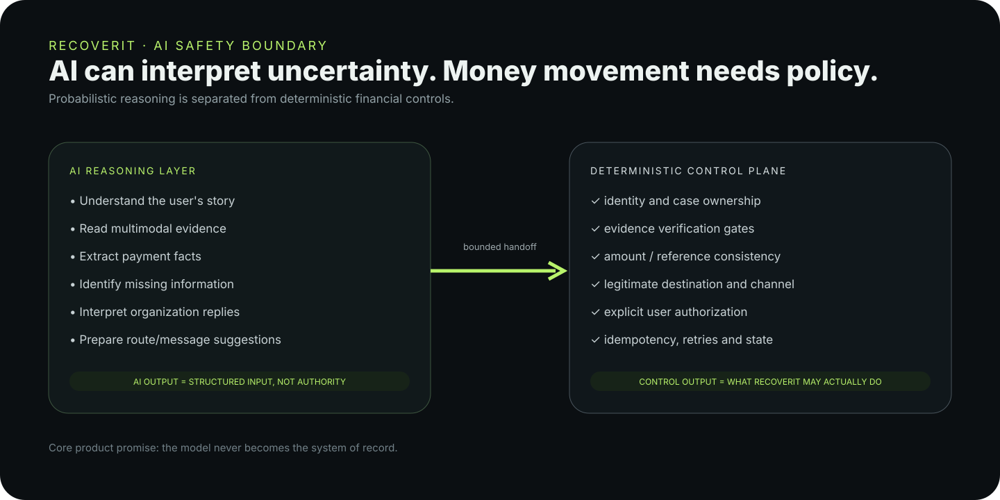

# AI Safety Boundary

RecoverIT treats AI as an interpretation layer, not a financial authority.

## AI may

- parse natural-language payment stories;
- interpret documents and screenshots;
- extract candidate transaction facts;
- identify missing or conflicting information;
- summarize provider responses;
- prepare route and message suggestions.

## Deterministic code decides

- authentication and case ownership;
- whether evidence is verified;
- whether required facts are present and consistent;
- whether a destination/channel is legitimate;
- whether an action is allowed by the case state;
- whether user approval exists;
- idempotency, retries, monitoring and resolution transitions.

## Failure principle

When the AI provider is unavailable or uncertain, the system preserves the case and uncertainty. It does not fabricate a payment state to keep the happy path moving.

## Product rule

> **AI interprets. Deterministic controls decide.**

This is especially important because the output of the system can influence a real financial-support workflow.