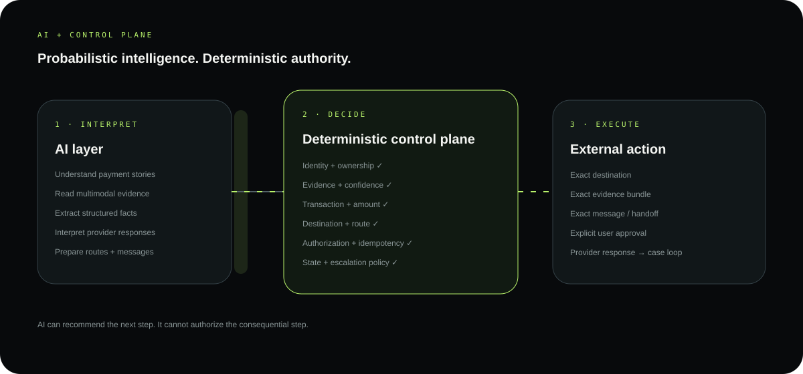
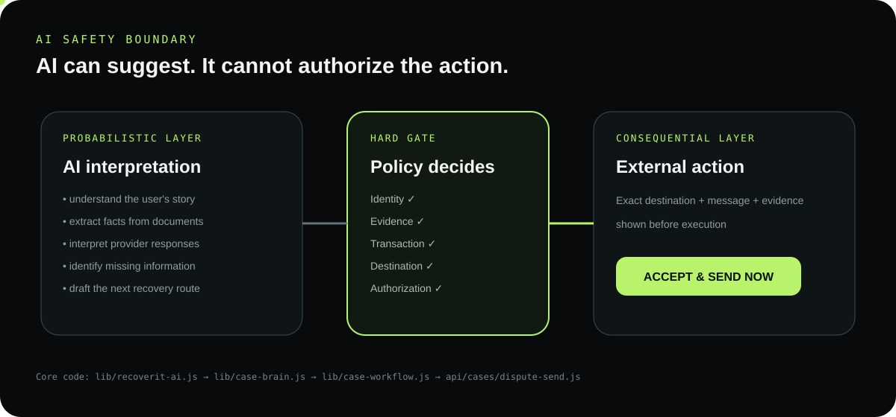

# RecoverIT architecture

> **Probabilistic intelligence. Deterministic authority.**

<p align="center">
  
</p>

## One picture

```text
CUSTOMER + EVIDENCE
        ↓
┌──────────────────────┐
│   AI INTERPRETATION  │  ← understand / extract / classify
└──────────┬───────────┘
           ↓
┌──────────────────────┐
│   DURABLE CASE       │  ← facts + evidence + workflow
│   + WORKFLOW LEDGER  │
└──────────┬───────────┘
           ↓
┌──────────────────────┐
│ DETERMINISTIC RULES  │  ← gates / route / approval
└──────────┬───────────┘
           ↓
     EXTERNAL ACTION
           ↓
   PROVIDER RESPONSE
           └──────────────→ CASE LOOP
```

## Three boundaries

| | Purpose |
|---|---|
| **01 · AI** | Understand messy human and document inputs. |
| **02 · Control plane** | Decide what is allowed and what happens next. |
| **03 · Execution** | Perform only the approved, legitimate action. |

### AI can

`interpret` · `extract` · `classify` · `find missing information` · `prepare`

### AI cannot

`authorize` · `invent payment facts` · `choose an illegitimate destination` · `bypass evidence gates` · `send without approval` · `declare money recovered`

## Case as the system of record

```text
                  ┌───────────────┐
                  │ RECOVERY CASE  │
                  └───────┬───────┘
          ┌───────────────┼───────────────┐
          ↓               ↓               ↓
       EVIDENCE        PAYMENT         PROVIDER
       + ANALYSIS      CONTEXT        RESPONSES
          └───────────────┼───────────────┘
                          ↓
                  WORKFLOW LEDGER
                          ↓
                  RECOVERY POLICY
                          ↓
                   USER APPROVAL
                          ↓
                  EXTERNAL ACTION
                          ↓
                     MONITORING
                          └────→ CASE
```

## Failure path

<p align="center">
  
</p>

```text
MODEL / PROVIDER TIMEOUT
          ↓
    PRESERVE CASE
          ↓
  RETRY / FALLBACK
          ↓
  RECONCILE STATE
          ↓
CONTINUE ONLY IF GATES PASS
```

A temporary AI outage becomes a recoverable workflow condition. A clear evidence rejection remains a hard gate.

## Scaling shape

```text
                 DURABLE CASE MODEL
                         │
        ┌────────────────┼────────────────┐
        ↓                ↓                ↓
   AI WORKERS      PROVIDER ADAPTERS   MONITORS
        │                │                │
        └────────────────┼────────────────┘
                         ↓
                  WORKFLOW LEDGER
```

Execution can scale independently while the case remains the stable source of progress.

## Core code

| Boundary | Implementation |
|---|---|
| Workflow | `lib/case-workflow.js` |
| Evidence | `lib/case-verification.js` |
| AI gateway | `lib/recoverit-ai.js` |
| Case reasoning | `lib/case-brain.js` |
| Recovery policy | `lib/dispute.js` |
| Approval gate | `api/cases/dispute-send.js` |
| Background work | `api/jobs/workflow-heartbeat.js` |
| Integrations | `api/integrations/` |

[Back to repository](../../README.md) · [Workflow](./WORKFLOW.md) · [Security](./SECURITY.md)