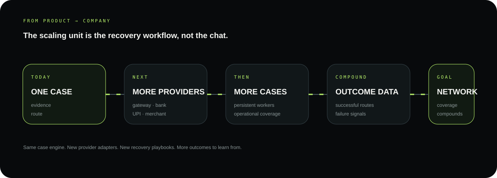

# RecoverIT scalability

RecoverIT's scaling unit is the **recovery workflow**, not the chat message.

## Today

One case stores:

- story;
- evidence;
- structured facts;
- payment context;
- provider route;
- action attempts;
- response requirements;
- workflow state;
- monitoring state;
- resolution projection.

## Scaling path

```text
ONE CASE
   ↓
MORE PROVIDERS
   ↓
MORE CASES
   ↓
MORE OUTCOME DATA
   ↓
BETTER PLAYBOOKS
   ↓
MORE SAFE AUTOMATION
   ↓
PAYMENT-RESOLUTION NETWORK
```

<p align="center">
  
</p>

## Execution layer

As volume grows, the same customer-facing workflow can be supported by:

- batched workers;
- provider-specific queues/adapters;
- event-driven monitoring;
- horizontally scaled integrations;
- stronger observability;
- provider playbook/versioning;
- outcome datasets for route-quality measurement.

## Data advantage

Each resolved case can produce structured operational signals:

```text
issue type
provider
route
required evidence
response pattern
failure reason
resolution outcome
```

That creates the basis for improving route selection and reducing manual effort without allowing the model to become the authority over money movement.

## Product expansion

The same durable engine can support more payment contexts without changing the core customer journey:

- cards;
- UPI;
- bank transfers;
- merchant refunds;
- payment gateways;
- future provider adapters.