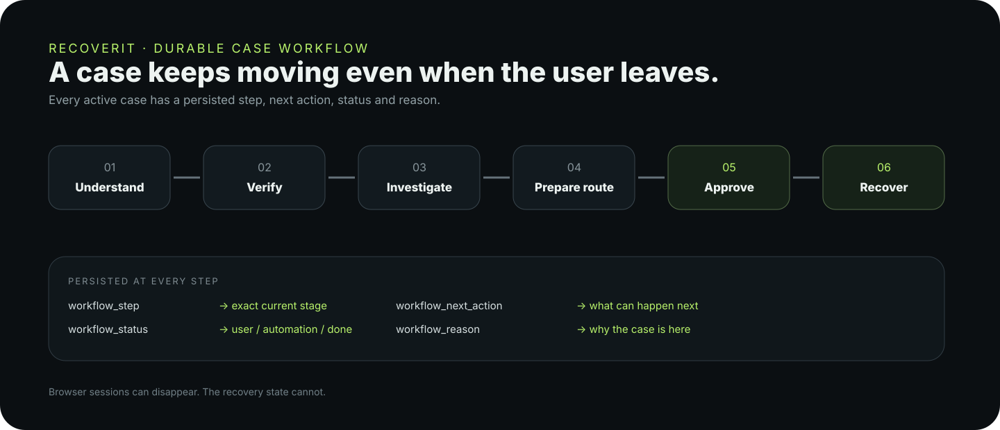

# RecoverIT Workflow

RecoverIT models a payment problem as a durable state machine.



## Canonical journey

```text
UNDERSTAND
→ VERIFY
→ INVESTIGATE
→ PREPARE ROUTE
→ USER APPROVAL
→ CONTACT / GUIDED HANDOFF
→ AWAIT RESPONSE
→ USER ACTION / MONITOR
→ RECOVER / ESCALATE
→ RESOLVE
```

## Durable state

The `recovery_cases` workflow ledger persists:

- current workflow step;
- exact next action;
- active / waiting / done status;
- reason for the state;
- trigger that last changed the workflow;
- workflow update timestamp.

## Important behavior

A user can close the browser after evidence upload and return later. The case does not restart from the beginning. A worker can re-enter the case from the saved position and continue reconciliation.

## User-action gates

A case must satisfy the current evidence and payment-fact requirements before external contact is prepared. Consequential external contact requires explicit user approval. The UI shows the exact organization, channel, destination, subject/message where applicable, and evidence that will be used.

## Exceptions

RecoverIT intentionally stops or waits when evidence is rejected, verification is unavailable, facts conflict, a legitimate route cannot be established, required user information is missing, or external authorization is required.